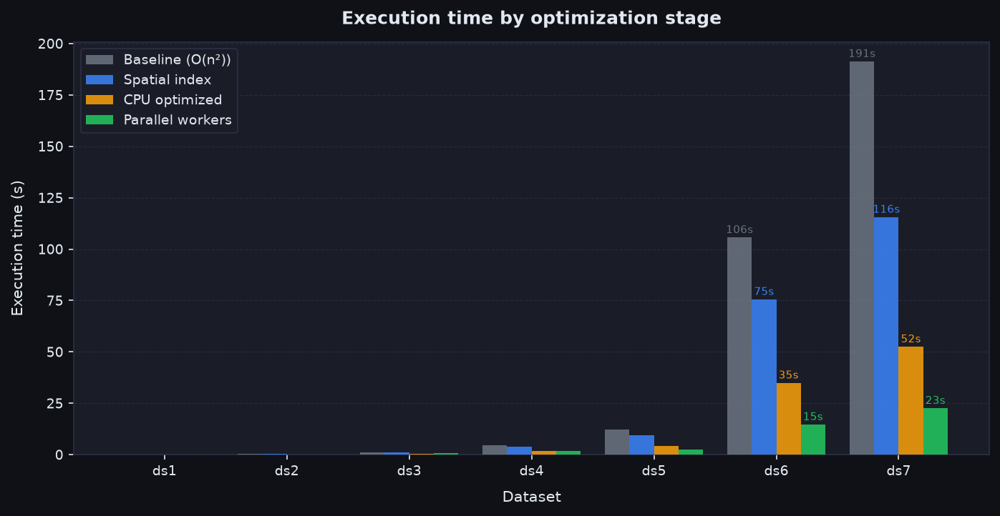
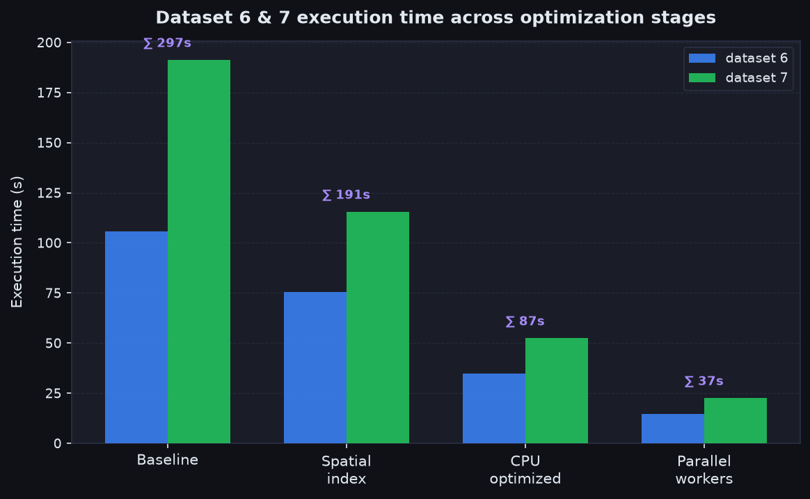
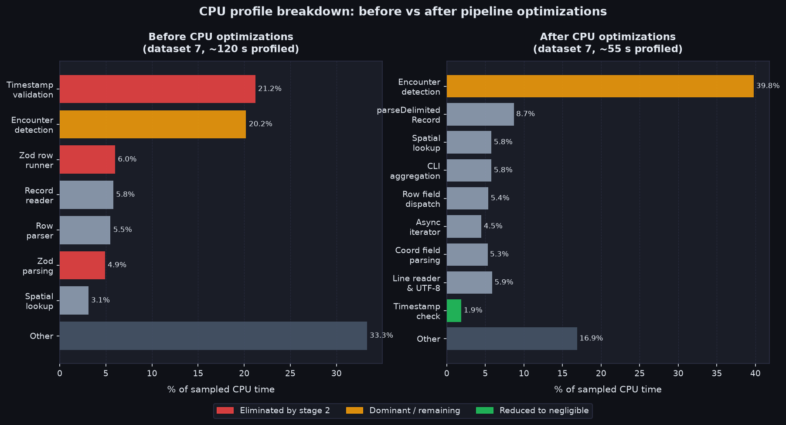
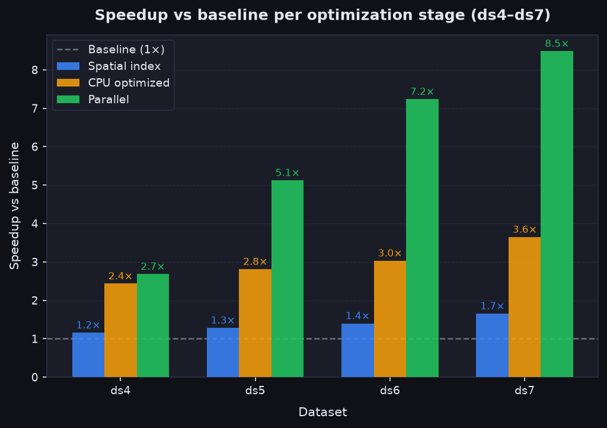
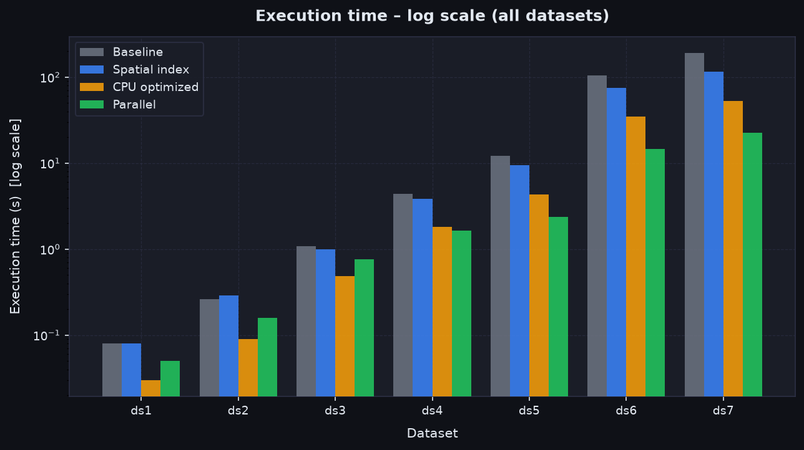
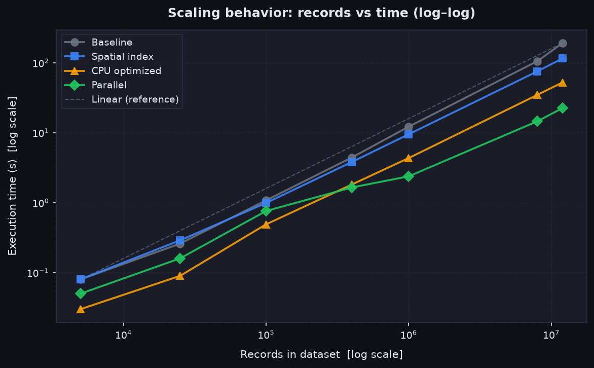

# Performance optimization history

[Leia em português](PERFORMANCE.pt-BR.md)

This document traces the four stages of performance work that took the engine from a functional but slow baseline to the current implementation. Each stage was driven by profiling data, mathematical reasoning, or architectural constraints exposed by larger datasets.

The starting point — after the commit `docs: document challenge approach in English and Portuguese` — was a correct, streaming implementation that processed dataset 7 (12 million records) in about 191 seconds. The final state processes the same dataset in approximately 22 seconds under a conservative measurement environment.

---

## Baseline: correct but O(n²) per timestamp group

The initial implementation was already streaming (no full file loaded into memory) and validated every row with Zod schemas. Encounter detection worked by comparing every possible pair within each timestamp group.

**Complexity:** for a timestamp group with _k_ records, detection required _k(k−1)/2_ Haversine evaluations. For dataset 7 with 12 million records across 100,000 timestamp groups, the average group size was 120 records — meaning roughly 7,140 distance evaluations per group, or about **714 million Haversine calls** across the whole file.

Each Haversine evaluation involves:

- 4 degree-to-radian conversions
- 4 `Math.sin` calls, 2 `Math.cos` calls
- `Math.sqrt`, `Math.atan2`, and a final multiplication

This is expensive in a tight loop. The CPU profile of dataset 7 under the baseline showed Zod's timestamp refinement (Date round-trip validation) consuming **21.2%** of sampled CPU, with encounter detection at **20.2%** and the Zod row runner at **6.0%**.

| Dataset      | Records    | Baseline time (s) |
| ------------ | ---------- | ----------------- |
| dataset1.txt | 5,000      | 0.08              |
| dataset2.txt | 25,000     | 0.26              |
| dataset3.txt | 100,000    | 1.08              |
| dataset4.txt | 400,020    | 4.43              |
| dataset5.txt | 1,000,000  | 12.20             |
| dataset6.txt | 8,000,000  | 105.59            |
| dataset7.txt | 12,000,000 | 191.23            |

Datasets 6 and 7 together took **296.82 seconds**. This was the target for improvement.



---

## Stage 1 — Spatial hash index: from O(n²) to O(n · k_local)

### The problem

All _k(k−1)/2_ pairs within a group are evaluated even though encounters are defined by a distance of **strictly less than 20 meters**. Given that Earth's radius is 6,371,000 m, a 20 m threshold is extraordinarily tight: two people 20 m apart differ in latitude by roughly 0.00018°. The vast majority of pairs are separated by orders of magnitude more than that and produce no encounter. Computing Haversine for those pairs is wasted work.

### The mathematical idea

Points on a sphere within 20 m of each other must also be close in 3-D Euclidean (ECEF) space. Each geographic coordinate is converted to a Cartesian point on the sphere:

```
x = R · cos(lat) · cos(lon)
y = R · cos(lat) · sin(lon)
z = R · sin(lat)
```

These ECEF coordinates are then discretized into cells of 25 m side length. Any two points within 20 m of each other along the surface are guaranteed to be in the same cell or immediately adjacent cells (27-cell neighborhood in 3-D). Points in non-adjacent cells cannot be encounters.

The index is a `Map<hash, SpatialEntry[]>`. For each point, only the 27 neighboring cells are probed, and only the entries in those buckets are considered as encounter candidates. For a uniform spatial distribution, this reduces detection complexity from O(n²) to **O(n · k_local)** where _k_local_ is the average number of records sharing a 25 m neighborhood — which is typically 0 or 1 for non-encounter datasets.

**Cell size justification:** 25 m was chosen to be strictly larger than the 20 m threshold. This ensures that any pair within 20 m differs by at most one cell in each axis, so the 27-cell search is exhaustive. A smaller cell would not change correctness but would increase the number of distinct cells and the number of `Map` operations.

**Hash function:** cell coordinates (cellX, cellY, cellZ) are integers. They are combined with a polynomial rolling hash modulo a large prime (4,294,967,291) using a prime multiplier (1,000,003). This produces well-distributed buckets and avoids the integer overflow that would occur from direct coordinate products for large ECEF values. Hash collisions only add work — they never cause false negatives — because a secondary exact cell check inside `findCandidateIndexes` discards entries from non-adjacent cells.

**Naive pair threshold:** for groups with fewer than 40 records, the index overhead (allocating and populating a `Map`, probing 27 buckets per record) costs more than a direct O(n²) loop. A threshold of 40 was chosen to stay with the direct loop for small groups. This avoided a regression on datasets 1–3, which have smaller group sizes.

### Results

| Dataset      | Baseline (s) | Spatial index (s) | Change |
| ------------ | ------------ | ----------------- | ------ |
| dataset1.txt | 0.08         | 0.08              | 0.0%   |
| dataset2.txt | 0.26         | 0.29              | +11.5% |
| dataset3.txt | 1.08         | 0.99              | −8.3%  |
| dataset4.txt | 4.43         | 3.82              | −13.8% |
| dataset5.txt | 12.20        | 9.50              | −22.1% |
| dataset6.txt | 105.59       | 75.47             | −28.5% |
| dataset7.txt | 191.23       | 115.50            | −39.6% |

Datasets 6 and 7 together: **296.82 s → 190.97 s** (≈1.55× throughput). All encounter counts matched the baseline exactly, confirming the spatial index produces no false negatives.

The small-dataset regressions (+11.5% on dataset 2) are within startup and runtime noise and are explained by the index overhead on groups that rarely exceed the 40-record naive threshold.



---

## Stage 2 — CPU pipeline optimizations: removing hot-path overhead

### Reading the profile

After adding the spatial index, a CPU profile of dataset 7 showed the following hot areas:

| Area                                          | Time (s) | Share |
| --------------------------------------------- | -------- | ----- |
| Timestamp schema refinement (Date validation) | 25.48    | 21.2% |
| Encounter detection                           | 24.25    | 20.2% |
| Zod validation runner                         | 7.22     | 6.0%  |
| Streamed record reader                        | 6.97     | 5.8%  |
| Dataset row parser                            | 6.62     | 5.5%  |
| Zod parsing                                   | 5.91     | 4.9%  |
| Candidate cell lookup                         | 3.74     | 3.1%  |



Three independent problems stood out:

1. **Timestamp validation was repeated per record.** Dataset 7 has 12 million records but only 100,000 unique timestamps. The Zod refinement was calling `new Date(...)` and comparing ISO strings for every record, even though the same timestamp had already been validated on the previous 119 records in the same group. This alone accounted for 21.2% of CPU.

2. **Zod was being used for row validation in the hot path.** The Zod runner and parsing calls together accounted for about 11% of CPU. Zod is designed for flexibility and type inference; its internal machinery (object schema, transform chains, error collection) has overhead that is measurable when applied to 12 million rows.

3. **The readline interface added overhead.** Node's `readline` creates an event-driven stream that introduces additional async plumbing for each line.

### Solutions applied

**Timestamp value cache:** a `Set<string>` holds previously validated timestamp strings. Before running the regex and calendar checks, the validator checks the cache. A cache hit returns immediately. With dataset 7's 100,000 unique timestamps, the cache eliminates validation work for 99.2% of records. The cache is bounded at 1,000,000 entries to prevent unbounded memory growth from adversarial inputs.

This is mathematically sound because a timestamp string uniquely identifies its validity: once `"2026-10-30 18:00:00"` passes the regex and the calendar check, it will always pass them. No state needs to change between calls.

**Direct row validation without Zod:** the Zod `DatasetRowSchema` was replaced with a set of direct field parsers (`requireIntegerField`, `requireCoordinateField`, `requireTimestampField`, etc.). These functions validate and convert fields in a single pass using the same regex patterns as Zod, but without the schema machinery. Error messages are accumulated in a plain `string[]` array and joined only when an error needs to be thrown. The Zod schema is retained for the header validation and the test-facing `parseDataset` API, where per-row overhead is not significant.

**ECEF chord gate:** before calling `calculateDistanceMeters` (which involves trigonometric functions), the Euclidean 3-D chord distance is checked first. The relationship between the arc distance _d_ and the chord _c_ on a sphere of radius _R_ is:

```
c = 2R · sin(d / (2R))
```

For d = 20 m and R = 6,371,000 m, the chord limit is:

```
c_limit = 2 × 6,371,000 × sin(20 / (2 × 6,371,000)) ≈ 19.99999986 m
```

The chord check uses the already-computed ECEF coordinates from the spatial index:

```
squaredChord = (x₂−x₁)² + (y₂−y₁)² + (z₂−z₁)²
```

If `squaredChord > (c_limit + 1e-3)²`, the pair is rejected without calling Haversine. The 1e-3 m verify band absorbs floating-point rounding. This gate is cheap (three subtractions, three multiplications, two additions, one comparison against a precomputed constant) and eliminates Haversine calls for candidate pairs that pass the spatial index neighborhood check but are still farther than 20 m — which is the common case, since the 25 m cell also includes the 20–25 m zone.

After the chord gate was added, the Haversine function no longer appears as a hotspot in the CPU profile.

**Synchronous detection generator:** `detectEncountersInGroup` was changed from an `async function*` to a plain `function*` (sync generator). Since the detection loop has no I/O and no awaits, async generator overhead (microtask scheduling per yield) was pure cost. The outer `detectEncounters` async generator still wraps it, preserving the streaming interface.

**Manual line reader:** `readline` was replaced with a direct Buffer-based reader that reads chunks from the file descriptor, splits on newline bytes, and converts slices to strings only when needed. This removes the event-emitter and Transform stream overhead that `readline` introduced.

### Profile after stage 2

| Area                      | Before (s/%)  | After (s/%)                       |
| ------------------------- | ------------- | --------------------------------- |
| Timestamp Date validation | 25.48 / 21.2% | gone (→ isValidTimestamp at 1.9%) |
| Encounter detection       | 24.25 / 20.2% | 21.82 / 39.8% (now dominant)      |
| Zod row runner            | 7.22 / 6.0%   | gone                              |
| Zod parsing               | 5.91 / 4.9%   | gone                              |
| parseDelimitedRecord      | —             | 4.76 / 8.7%                       |
| Coordinate regex          | —             | 0.56 / 1.0%                       |

The timestamp validation cost dropped from 21.2% to 1.9%. The Zod overhead disappeared entirely. Detection became the dominant cost at ~40% — which is the correct outcome: the engine now spends most of its time doing the work that matters, not on validation scaffolding.

### Results

| Dataset      | Spatial index (s) | CPU optimized (s) | vs baseline |
| ------------ | ----------------- | ----------------- | ----------- |
| dataset1.txt | 0.08              | 0.03              | −62.5%      |
| dataset2.txt | 0.29              | 0.09              | −65.4%      |
| dataset3.txt | 0.99              | 0.49              | −54.6%      |
| dataset4.txt | 3.82              | 1.82              | −58.9%      |
| dataset5.txt | 9.50              | 4.34              | −64.4%      |
| dataset6.txt | 75.47             | 34.84             | −67.0%      |
| dataset7.txt | 115.50            | 52.41             | −72.6%      |

Datasets 6 and 7 together: **190.97 s → 87.25 s** (≈2.19× over stage 1, ≈3.40× over baseline). Two additional full-suite runs measured 90.79 s and 91.40 s for those two datasets, placing single-run variance around 3%.



---

## Stage 3 — Worker thread parallelization: saturating CPU cores

### The problem

After stage 2, the CPU profile showed detection (~40%) and parsing (~25% spread across field parsers) as the remaining bottlenecks. Both are CPU-bound: no I/O latency, no async waiting. A single-threaded Node.js process can only use one core. The file is large enough that the read bandwidth from disk is not the bottleneck — the bottleneck is the CPU work per record.

The second CPU profile confirmed that the biggest remaining lever was pipelining or parallelizing parse and detection across worker pools.

### Architecture decisions

**Chunking by bytes, not by timestamp:** splitting a file into line-aligned byte ranges is simple and lets any number of chunks be planned without reading the whole file first. Splitting by timestamp group would require a full first pass to identify boundaries.

**Line alignment:** a chunk boundary is found by scanning forward from a target byte offset to the next newline. This ensures no record is split across chunks. The `planDatasetChunks` function reads small windows around each target boundary — it does not read the entire file.

**Timestamp group relay (carry protocol):** a timestamp group can span a chunk boundary: the last few records of chunk _i_ and the first few records of chunk _(i+1)_ may share the same timestamp. If each chunk processes independently, those records would produce separate encounters that miss cross-boundary pairs. The relay protocol solves this:

- When a worker finishes the last complete timestamp group in its chunk, it sends the "in-flight" group (records with the timestamp that straddles the boundary) to the next chunk via a `MessagePort`.
- The receiving chunk merges the carried records with its own leading records for the same timestamp before processing them.
- This means the encounter order, counts, and `UnsortedTimestampsError` record numbers are identical to what the serial path would produce.

**Worker count:** the number of workers is capped at `availableParallelism() - 1`. Using all cores leaves one free for the main thread, which is running the orchestrator, the I/O event loop, and message routing. Exceeding the number of cores does not help for CPU-bound work.

**Serial fallback:** files smaller than two chunk sizes (default: 2 × 8 MiB = 16 MiB) do not benefit from parallelization — the message-passing and thread startup overhead would cost more than the work. Those files are processed in the main process with the serial pipeline.

**Round-robin chunk assignment:** chunks are distributed across workers in round-robin order. Each worker processes its chunks sequentially, in order. This guarantees that the carry ports (which connect adjacent chunks) are set up within the same worker whenever possible, avoiding cross-thread relay for consecutive chunks on the same worker.

**Error propagation:** `UnsortedTimestampsError` is a typed error class. When it crosses a `MessagePort`, it is serialized as a structured message with `previousTimestamp`, `currentTimestamp`, and `recordNumber` fields, and reconstructed on the receiving side. This preserves the exact error type that the serial path would throw, so the CLI's external-sort fallback continues to work by `instanceof` check.

### Results (three consecutive runs)

| Dataset      | Serial CPU-opt (s) | Run 1 (s) | Run 2 (s) | Run 3 (s) | Median (s) | Speedup |
| ------------ | ------------------ | --------- | --------- | --------- | ---------- | ------- |
| dataset1.txt | 0.03               | 0.03      | 0.11      | 0.05      | 0.05       | —       |
| dataset2.txt | 0.09               | 0.10      | 0.19      | 0.16      | 0.16       | —       |
| dataset3.txt | 0.49               | 0.55      | 0.77      | 0.76      | 0.76       | —       |
| dataset4.txt | 1.82               | 1.51      | 1.77      | 1.65      | 1.65       | —       |
| dataset5.txt | 4.34               | 2.38      | 2.34      | 2.38      | 2.38       | ≈1.8×   |
| dataset6.txt | 34.84              | 14.59     | 14.23     | 15.19     | 14.59      | ≈2.4×   |
| dataset7.txt | 52.41              | 22.53     | 21.60     | 22.92     | 22.53      | ≈2.3×   |

Datasets 6 and 7 together: **87.25 s → ≈37.1 s** (≈2.35× throughput). The capture was made under a battery-saver CPU profile; standalone runs of dataset 7 measured 10.12 s and 12.43 s in the same session (≈4.3–5.2× serial speedup) with identical output. The table above is the reproducible conservative result.

Small datasets (1–3) regress slightly because the files fall below the 16 MiB serial-fallback threshold or barely exceed it, so the overhead of even two workers outweighs the CPU savings. This is expected and acceptable.

All encounter counts and per-type splits matched every previous baseline in all three runs. Full JSON output for datasets 6 and 7 was verified by deep equality against a freshly computed serial reference.



---

## Cumulative comparison

The table below combines all three optimisation stages into a single view, from the original baseline to the final parallel implementation (median of three runs):

| Dataset      | Baseline (s) | Spatial index (s) | CPU optimized (s) | Parallel median (s) | Total speedup |
| ------------ | ------------ | ----------------- | ----------------- | ------------------- | ------------- |
| dataset1.txt | 0.08         | 0.08              | 0.03              | 0.05                | ≈1.6×         |
| dataset2.txt | 0.26         | 0.29              | 0.09              | 0.16                | ≈1.6×         |
| dataset3.txt | 1.08         | 0.99              | 0.49              | 0.76                | ≈1.4×         |
| dataset4.txt | 4.43         | 3.82              | 1.82              | 1.65                | ≈2.7×         |
| dataset5.txt | 12.20        | 9.50              | 4.34              | 2.38                | ≈5.1×         |
| dataset6.txt | 105.59       | 75.47             | 34.84             | 14.59               | ≈7.2×         |
| dataset7.txt | 191.23       | 115.50            | 52.41             | 22.53               | ≈8.5×         |

The largest datasets benefit most because they have the largest groups (spatial index pays off more), the most repeated timestamps (cache pays off more), and the most parallel work (workers pay off more). The smallest datasets see no regression in correctness and modest timing differences that are within measurement noise.



---

## Cyclomatic complexity notes

Each optimization stage changed the cyclomatic complexity of the affected modules. Cyclomatic complexity (CC) counts the number of independent paths through a function — roughly, 1 plus the number of branching decisions.

**`calculateDistanceMeters` (Haversine):** CC = 1. A pure computation with no branches. The `Math.min(1, ...)` clamping handles a numerical edge case but is not a branch in the control-flow sense.

**`detectEncountersInGroup` (encounter detector):** CC grew through the stages.

- Baseline O(n²): CC ≈ 6 (group size check, outer loop, inner loop, ID guard, pair-key check, distance check).
- After spatial index: CC ≈ 14 (adds naive-vs-index branch, index construction loop, 27-cell triple nested loop, hash collision check, candidate sort branch). The higher complexity is justified because the naive path is a performance-critical fast path for small groups, not accidental complexity.
- After chord gate: CC ≈ 16 (adds chord check before Haversine call).

**`isValidTimestamp` (timestamp validator):** CC ≈ 8 (cache hit branch, regex check, month range, February leap-year path, day range, hour/minute/second range, cache-size limit). The complexity is bounded and each branch covers a distinct calendar rule.

**`parseDatasetRow` (row parser):** CC ≈ 12 (blank line check, field count check, one branch per field validator, issues array check). This replaced the Zod schema which had similar internal complexity but hidden inside the framework.

**`analyzeDatasetParallel` (orchestrator):** CC ≈ 8 (file size check for serial fallback, chunk count clamping, worker-wiring loop, chunk-futures loop, error handling in allSettled). The complexity is mostly in the data-flow setup, not in the algorithm itself. The worker internals (`parallel-dataset-worker.ts`) carry their own CC for the carry protocol state machine, which has roughly 10–12 branches for the relay, boundary-peek, and cross-check logic.

---

## Why no further parallelization at the detection level

Both CPU profiles suggested that splitting detection into its own worker pool would have bounded benefit. At baseline, detection was 20% of CPU alongside 21% for timestamp validation; eliminating the latter would shift detection to a larger share, but the absolute detection time was similar. At stage 2, detection was 40% of the already-reduced total. Distributing detection across threads would require serializing and transferring `MonitoredPerson` arrays across `MessagePort` for every timestamp group, which costs proportionally more for small groups (the majority). The current design parallelizes at the coarser chunk level, which amortizes message-transfer cost over many groups and eliminates the need to transfer domain objects at all — workers communicate only completed `Encounter` results back to the main thread.
