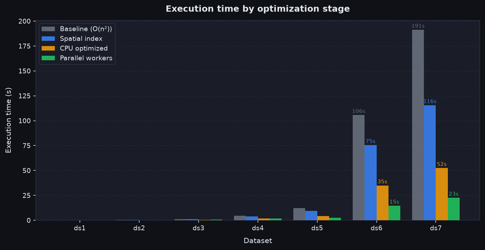
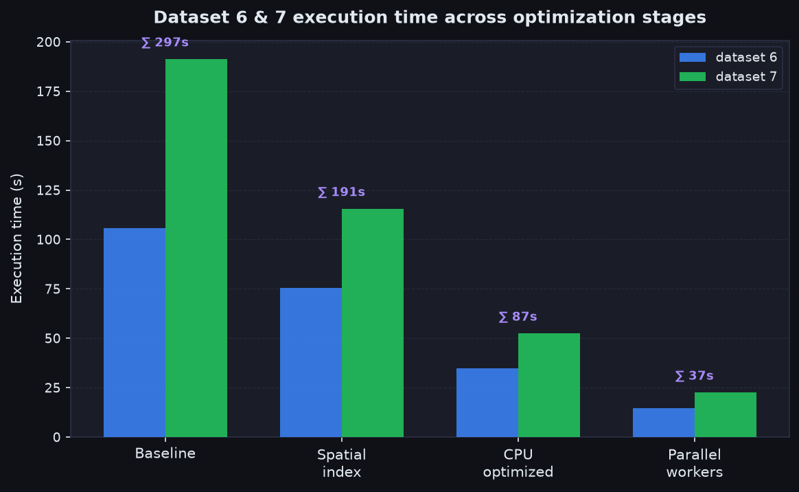
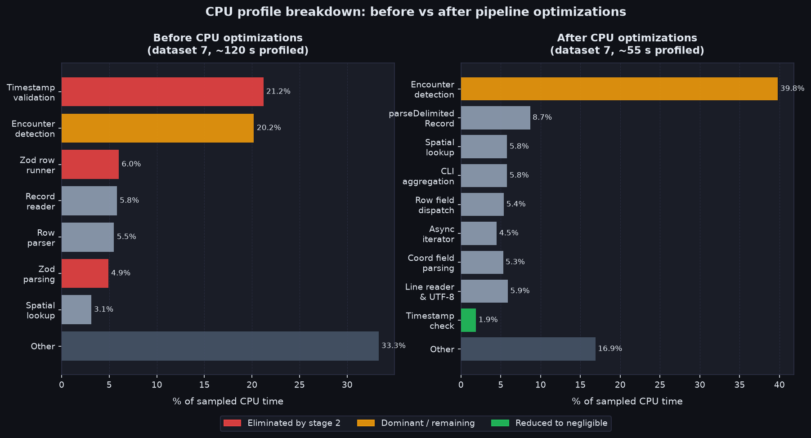
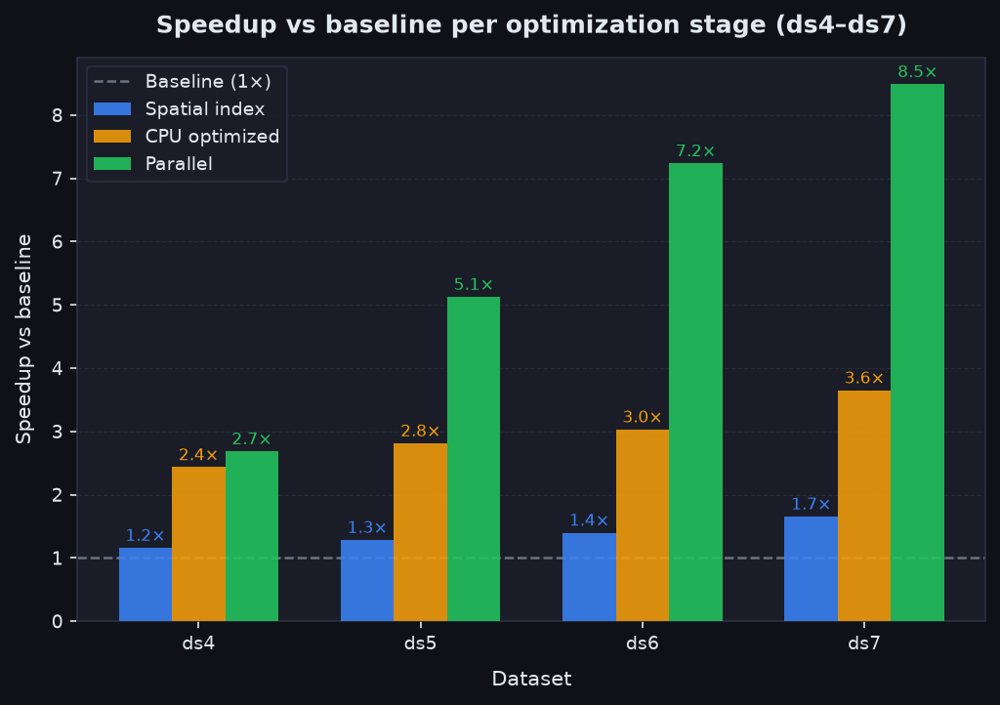
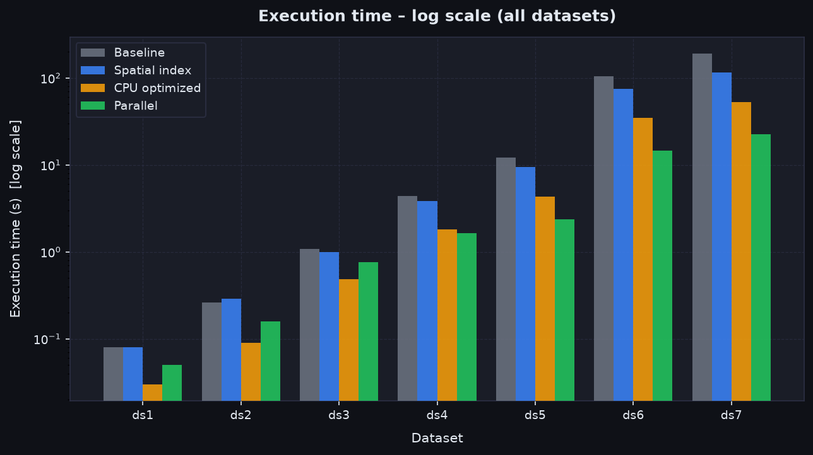
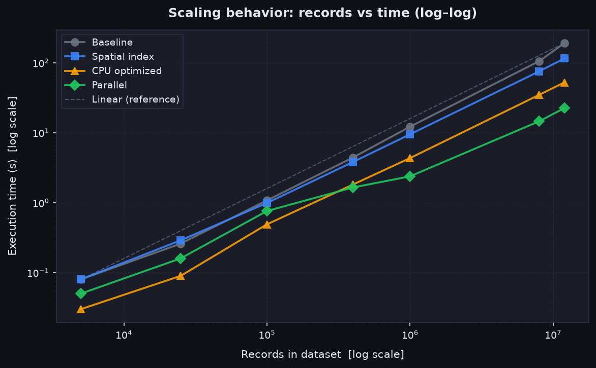

# Histórico de otimização de desempenho

[Read this document in English](PERFORMANCE.md)

Este documento descreve as quatro etapas de trabalho de desempenho que levaram o motor de uma linha de base funcional, porém lenta, até a implementação atual. Cada etapa foi orientada por dados de perfil de CPU, raciocínio matemático ou restrições arquiteturais reveladas pelos conjuntos de dados maiores.

O ponto de partida — após o commit `docs: document challenge approach in English and Portuguese` — era uma implementação correta e em fluxo contínuo que processava o dataset 7 (12 milhões de registros) em cerca de 191 segundos. O estado final processa o mesmo dataset em aproximadamente 22 segundos em um ambiente de medição conservador.

---

## Ambiente de teste

Todos os benchmarks foram capturados na seguinte máquina:

| Componente        | Detalhes                                                                                                        |
| ----------------- | --------------------------------------------------------------------------------------------------------------- |
| CPU               | Intel Core i5-10500H @ 2,50 GHz                                                                                 |
| Núcleos / threads | 6 núcleos / 12 processadores lógicos                                                                            |
| Perfil de energia | **Economia de energia (baixo desempenho)** — configuração conservadora usada em todas as execuções documentadas |

O estágio paralelo satura os threads disponíveis via `availableParallelism() - 1`, de modo que o perfil de energia tem impacto perceptível nos resultados. A título de curiosidade, executar o dataset 7 com o perfil de **alto desempenho** reduziu o tempo de execução de ~22 s para ~12 s — aproximadamente 1,8× de ganho sobre o resultado em economia de energia somente para esse dataset.

Todas as tabelas deste documento refletem os números em modo economia de energia e são, portanto, conservadoras em relação ao que o mesmo código alcançaria em uma carga de trabalho típica de desenvolvimento ou servidor.

---

## Linha de base: correta, mas O(n²) por grupo de timestamp

A implementação inicial já era em fluxo contínuo (nenhum arquivo carregado inteiramente na memória) e validava cada linha com esquemas Zod. A detecção de encontros funcionava comparando todos os pares possíveis dentro de cada grupo de timestamp.

**Complexidade:** para um grupo de timestamp com _k_ registros, a detecção exigia _k(k−1)/2_ avaliações de Haversine. Para o dataset 7, com 12 milhões de registros distribuídos em 100.000 grupos de timestamp, o tamanho médio do grupo era de 120 registros — o que significa cerca de 7.140 cálculos de distância por grupo, ou aproximadamente **714 milhões de chamadas Haversine** em todo o arquivo.

Cada avaliação de Haversine envolve:

- 4 conversões de graus para radianos
- 4 chamadas `Math.sin`, 2 chamadas `Math.cos`
- `Math.sqrt`, `Math.atan2` e uma multiplicação final

Isso é custoso em um laço apertado. O perfil de CPU do dataset 7 na linha de base mostrou que o refinamento de timestamp do Zod (validação por ida e volta com `Date`) consumia **21,2%** do CPU amostrado, com detecção de encontros em **20,2%** e o executor de esquemas Zod em **6,0%**.

| Dataset      | Registros  | Tempo base (s) |
| ------------ | ---------- | -------------- |
| dataset1.txt | 5.000      | 0,08           |
| dataset2.txt | 25.000     | 0,26           |
| dataset3.txt | 100.000    | 1,08           |
| dataset4.txt | 400.020    | 4,43           |
| dataset5.txt | 1.000.000  | 12,20          |
| dataset6.txt | 8.000.000  | 105,59         |
| dataset7.txt | 12.000.000 | 191,23         |

Os datasets 6 e 7 juntos levavam **296,82 segundos**. Esse era o alvo de melhoria.



---

## Etapa 1 — Índice hash espacial: de O(n²) para O(n · k_local)

### O problema

Todos os _k(k−1)/2_ pares dentro de um grupo eram avaliados, mesmo que os encontros sejam definidos por uma distância **estritamente menor que 20 metros**. Dado que o raio da Terra é 6.371.000 m, um limiar de 20 m é extraordinariamente restrito: duas pessoas a 20 m de distância diferem em latitude em aproximadamente 0,00018°. A grande maioria dos pares está separada por ordens de grandeza acima disso e não produz encontro algum. Calcular Haversine para esses pares é trabalho desperdiçado.

### A ideia matemática

Pontos em uma esfera que estejam a menos de 20 m entre si também precisam estar próximos no espaço euclidiano 3D (ECEF). Cada coordenada geográfica é convertida em um ponto cartesiano na esfera:

```
x = R · cos(lat) · cos(lon)
y = R · cos(lat) · sin(lon)
z = R · sin(lat)
```

Essas coordenadas ECEF são então discretizadas em células de 25 m de lado. Quaisquer dois pontos dentro de 20 m ao longo da superfície estão garantidamente na mesma célula ou em células imediatamente adjacentes (vizinhança de 27 células em 3D). Pontos em células não adjacentes não podem ser encontros.

O índice é um `Map<hash, SpatialEntry[]>`. Para cada ponto, apenas as 27 células vizinhas são examinadas, e somente as entradas nesses buckets são consideradas candidatas a encontro. Para uma distribuição espacial uniforme, isso reduz a complexidade da detecção de O(n²) para **O(n · k_local)**, onde _k_local_ é o número médio de registros que compartilham uma vizinhança de 25 m — normalmente 0 ou 1 em datasets sem encontros.

**Justificativa do tamanho da célula:** 25 m foi escolhido por ser estritamente maior que o limiar de 20 m. Isso garante que qualquer par dentro de 20 m difere em no máximo uma célula em cada eixo, tornando a busca das 27 células exaustiva. Uma célula menor não alteraria a correção, mas aumentaria o número de células distintas e o número de operações no `Map`.

**Função hash:** as coordenadas de célula (cellX, cellY, cellZ) são inteiros. Elas são combinadas com um hash polinomial rolante módulo um primo grande (4.294.967.291) usando um multiplicador primo (1.000.003). Isso produz buckets bem distribuídos e evita o overflow inteiro que ocorreria com produtos diretos de coordenadas para valores ECEF grandes. Colisões de hash apenas adicionam trabalho — nunca causam falsos negativos — porque uma verificação exata de célula secundária dentro de `findCandidateIndexes` descarta entradas de células não adjacentes.

**Limiar para comparação ingênua:** para grupos com menos de 40 registros, o custo do índice (alocar e preencher um `Map`, examinar 27 buckets por registro) é maior do que um laço O(n²) direto. O limiar de 40 foi escolhido para manter o laço direto em grupos pequenos, evitando regressão nos datasets 1–3, que possuem grupos menores.

### Resultados

| Dataset      | Base (s) | Índice espacial (s) | Variação |
| ------------ | -------- | ------------------- | -------- |
| dataset1.txt | 0,08     | 0,08                | 0,0%     |
| dataset2.txt | 0,26     | 0,29                | +11,5%   |
| dataset3.txt | 1,08     | 0,99                | −8,3%    |
| dataset4.txt | 4,43     | 3,82                | −13,8%   |
| dataset5.txt | 12,20    | 9,50                | −22,1%   |
| dataset6.txt | 105,59   | 75,47               | −28,5%   |
| dataset7.txt | 191,23   | 115,50              | −39,6%   |

Datasets 6 e 7 juntos: **296,82 s → 190,97 s** (≈1,55× de throughput). Todas as contagens de encontros corresponderam exatamente à linha de base, confirmando que o índice espacial não produz falsos negativos.

As regressões nos datasets pequenos (+11,5% no dataset 2) estão dentro do ruído de inicialização e tempo de execução, e se explicam pelo custo do índice em grupos que raramente ultrapassam o limiar de 40 registros para comparação ingênua.



---

## Etapa 2 — Otimizações de pipeline de CPU: eliminando overhead no caminho crítico

### Lendo o perfil

Após adicionar o índice espacial, um perfil de CPU do dataset 7 revelou as seguintes áreas quentes:

| Área                                                    | Tempo (s) | Participação |
| ------------------------------------------------------- | --------- | ------------ |
| Refinamento do schema de timestamp (validação com Date) | 25,48     | 21,2%        |
| Detecção de encontros                                   | 24,25     | 20,2%        |
| Executor de esquemas Zod                                | 7,22      | 6,0%         |
| Leitor de registros em fluxo                            | 6,97      | 5,8%         |
| Parser de linhas do dataset                             | 6,62      | 5,5%         |
| Parsing do Zod                                          | 5,91      | 4,9%         |
| Consulta de célula candidata                            | 3,74      | 3,1%         |



Três problemas independentes se destacaram:

1. **A validação de timestamp era repetida por registro.** O dataset 7 tem 12 milhões de registros, mas apenas 100.000 timestamps únicos. O refinamento do Zod chamava `new Date(...)` e comparava strings ISO para cada registro, mesmo que o mesmo timestamp já tivesse sido validado nos 119 registros anteriores do mesmo grupo. Isso sozinho respondia por 21,2% do CPU.

2. **O Zod era usado para validação de linhas no caminho crítico.** O executor e o parsing do Zod juntos respondiam por cerca de 11% do CPU. O Zod é projetado para flexibilidade e inferência de tipos; sua maquinaria interna (schema de objeto, cadeias de transform, coleta de erros) tem um custo mensurável quando aplicado a 12 milhões de linhas.

3. **A interface `readline` adicionava overhead.** O `readline` do Node cria um fluxo orientado a eventos que introduz encanamento assíncrono adicional para cada linha.

### Soluções aplicadas

**Cache de valores de timestamp:** um `Set<string>` armazena strings de timestamp já validadas. Antes de executar o regex e as verificações de calendário, o validador consulta o cache. Um acerto no cache retorna imediatamente. Com os 100.000 timestamps únicos do dataset 7, o cache elimina o trabalho de validação em 99,2% dos registros. O cache é limitado a 1.000.000 entradas para evitar crescimento ilimitado de memória com entradas adversariais.

Isso é matematicamente correto porque uma string de timestamp identifica univocamente sua validade: uma vez que `"2026-10-30 18:00:00"` passa no regex e na verificação de calendário, sempre passará. Nenhum estado precisa mudar entre chamadas.

**Validação de linha direta sem Zod:** o `DatasetRowSchema` do Zod foi substituído por um conjunto de parsers de campo diretos (`requireIntegerField`, `requireCoordinateField`, `requireTimestampField`, etc.). Essas funções validam e convertem campos em uma única passagem usando os mesmos padrões de regex do Zod, mas sem a maquinaria do schema. Mensagens de erro são acumuladas em um array `string[]` simples e concatenadas apenas quando é necessário lançar um erro. O schema Zod é mantido para a validação do cabeçalho e para a API `parseDataset` exposta aos testes, onde o custo por linha não é significativo.

**Gate de corda ECEF:** antes de chamar `calculateDistanceMeters` (que envolve funções trigonométricas), a distância euclidiana 3D da corda é verificada primeiro. A relação entre a distância de arco _d_ e a corda _c_ em uma esfera de raio _R_ é:

```
c = 2R · sen(d / (2R))
```

Para d = 20 m e R = 6.371.000 m, o limite da corda é:

```
c_limite = 2 × 6.371.000 × sen(20 / (2 × 6.371.000)) ≈ 19,99999986 m
```

A verificação da corda usa as coordenadas ECEF já calculadas pelo índice espacial:

```
cordaAoQuadrado = (x₂−x₁)² + (y₂−y₁)² + (z₂−z₁)²
```

Se `cordaAoQuadrado > (c_limite + 1e-3)²`, o par é rejeitado sem chamar Haversine. A banda de verificação de 1e-3 m absorve o arredondamento de ponto flutuante. Esse gate é barato (três subtrações, três multiplicações, duas adições, uma comparação com uma constante pré-calculada) e elimina chamadas Haversine para pares candidatos que passam pela verificação de vizinhança do índice espacial, mas ainda estão além de 20 m — o que é o caso comum, já que a célula de 25 m também inclui a zona de 20–25 m.

Após a adição do gate de corda, a função Haversine deixou de aparecer como ponto quente no perfil de CPU.

**Gerador de detecção síncrono:** `detectEncountersInGroup` foi alterado de `async function*` para um `function*` simples (gerador síncrono). Como o laço de detecção não tem I/O nem awaits, o overhead do gerador assíncrono (agendamento de microtarefas por yield) era custo puro. O gerador assíncrono externo `detectEncounters` ainda o envolve, preservando a interface em fluxo.

**Leitor de linhas manual:** o `readline` foi substituído por um leitor direto baseado em `Buffer` que lê chunks do descritor de arquivo, divide em bytes de nova linha e converte fatias para strings apenas quando necessário. Isso elimina o overhead do emissor de eventos e do stream `Transform` que o `readline` introduzia.

### Perfil após a etapa 2

| Área                            | Antes (s/%)   | Depois (s/%)                           |
| ------------------------------- | ------------- | -------------------------------------- |
| Validação de timestamp com Date | 25,48 / 21,2% | eliminado (→ isValidTimestamp em 1,9%) |
| Detecção de encontros           | 24,25 / 20,2% | 21,82 / 39,8% (agora dominante)        |
| Executor de esquemas Zod        | 7,22 / 6,0%   | eliminado                              |
| Parsing do Zod                  | 5,91 / 4,9%   | eliminado                              |
| parseDelimitedRecord            | —             | 4,76 / 8,7%                            |
| Regex de coordenada             | —             | 0,56 / 1,0%                            |

O custo de validação de timestamp caiu de 21,2% para 1,9%. O overhead do Zod desapareceu por completo. A detecção tornou-se o custo dominante em ~40% — que é o resultado correto: o motor agora passa a maior parte do tempo fazendo o trabalho que importa, não em infraestrutura de validação.

### Resultados

| Dataset      | Índice espacial (s) | CPU otimizado (s) | vs base |
| ------------ | ------------------- | ----------------- | ------- |
| dataset1.txt | 0,08                | 0,03              | −62,5%  |
| dataset2.txt | 0,29                | 0,09              | −65,4%  |
| dataset3.txt | 0,99                | 0,49              | −54,6%  |
| dataset4.txt | 3,82                | 1,82              | −58,9%  |
| dataset5.txt | 9,50                | 4,34              | −64,4%  |
| dataset6.txt | 75,47               | 34,84             | −67,0%  |
| dataset7.txt | 115,50              | 52,41             | −72,6%  |

Datasets 6 e 7 juntos: **190,97 s → 87,25 s** (≈2,19× sobre a etapa 1, ≈3,40× sobre a linha de base). Duas execuções adicionais completas mediram 90,79 s e 91,40 s para esses dois datasets, colocando a variância de execução única em torno de 3%.



---

## Etapa 3 — Paralelização com worker threads: saturando os núcleos de CPU

### O problema

Após a etapa 2, o perfil de CPU mostrou detecção (~40%) e parsing (~25% distribuído entre os parsers de campo) como os gargalos restantes. Ambos são CPU-bound: sem latência de I/O, sem awaits. Um processo Node.js single-thread só pode usar um núcleo. O arquivo é grande o suficiente para que a largura de banda de leitura do disco não seja o gargalo — o gargalo é o trabalho de CPU por registro.

O segundo perfil de CPU confirmou que a maior alavanca restante era fazer pipeline ou paralelizar parse e detecção em pools de workers.

### Decisões de arquitetura

**Divisão por bytes, não por timestamp:** dividir um arquivo em faixas de bytes alinhadas por linha é simples e permite planejar qualquer número de chunks sem ler o arquivo inteiro primeiro. Dividir por grupo de timestamp exigiria uma primeira passagem completa para identificar as fronteiras.

**Alinhamento por linha:** uma fronteira de chunk é encontrada avançando a partir de um offset de bytes alvo até o próximo caractere de nova linha. Isso garante que nenhum registro seja dividido entre chunks. A função `planDatasetChunks` lê pequenas janelas em torno de cada fronteira alvo — não lê o arquivo inteiro.

**Relay de grupo de timestamp (protocolo carry):** um grupo de timestamp pode abranger uma fronteira de chunk: os últimos registros do chunk _i_ e os primeiros do chunk _(i+1)_ podem compartilhar o mesmo timestamp. Se cada chunk processar de forma independente, esses registros produziriam encontros separados, perdendo os pares entre fronteiras. O protocolo de relay resolve isso:

- Quando um worker termina o último grupo de timestamp completo em seu chunk, envia o grupo "em voo" (registros com o timestamp que atravessa a fronteira) para o próximo chunk via `MessagePort`.
- O chunk receptor mescla os registros recebidos com seus próprios registros iniciais do mesmo timestamp antes de processá-los.
- Isso garante que a ordem dos encontros, as contagens e os números de registro em `UnsortedTimestampsError` sejam idênticos ao que o caminho serial produziria.

**Número de workers:** o número de workers é limitado a `availableParallelism() - 1`. Usar todos os núcleos deixa um livre para a thread principal, que executa o orquestrador, o event loop de I/O e o roteamento de mensagens. Superar o número de núcleos não ajuda em trabalho CPU-bound.

**Fallback serial:** arquivos menores que dois tamanhos de chunk (padrão: 2 × 8 MiB = 16 MiB) não se beneficiam da paralelização — o overhead de troca de mensagens e inicialização de threads custaria mais do que o trabalho em si. Esses arquivos são processados na thread principal com o pipeline serial.

**Atribuição round-robin de chunks:** os chunks são distribuídos entre os workers em ordem round-robin. Cada worker processa seus chunks sequencialmente, em ordem. Isso garante que as portas de carry (que conectam chunks adjacentes) sejam configuradas dentro do mesmo worker sempre que possível, evitando relay entre threads para chunks consecutivos no mesmo worker.

**Propagação de erros:** `UnsortedTimestampsError` é uma classe de erro tipada. Quando ela atravessa um `MessagePort`, é serializada como uma mensagem estruturada com os campos `previousTimestamp`, `currentTimestamp` e `recordNumber`, e reconstruída no lado receptor. Isso preserva o tipo exato de erro que o caminho serial lançaria, de modo que o fallback de ordenação externa da CLI continue funcionando por verificação `instanceof`.

### Resultados (três execuções consecutivas)

| Dataset      | Serial CPU-opt (s) | Exec. 1 (s) | Exec. 2 (s) | Exec. 3 (s) | Mediana (s) | Aceleração |
| ------------ | ------------------ | ----------- | ----------- | ----------- | ----------- | ---------- |
| dataset1.txt | 0,03               | 0,03        | 0,11        | 0,05        | 0,05        | —          |
| dataset2.txt | 0,09               | 0,10        | 0,19        | 0,16        | 0,16        | —          |
| dataset3.txt | 0,49               | 0,55        | 0,77        | 0,76        | 0,76        | —          |
| dataset4.txt | 1,82               | 1,51        | 1,77        | 1,65        | 1,65        | —          |
| dataset5.txt | 4,34               | 2,38        | 2,34        | 2,38        | 2,38        | ≈1,8×      |
| dataset6.txt | 34,84              | 14,59       | 14,23       | 15,19       | 14,59       | ≈2,4×      |
| dataset7.txt | 52,41              | 22,53       | 21,60       | 22,92       | 22,53       | ≈2,3×      |

Datasets 6 e 7 juntos: **87,25 s → ≈37,1 s** (≈2,35× de throughput). A captura foi feita com perfil de CPU em modo economia de energia; execuções avulsas do dataset 7 mediram 10,12 s e 12,43 s na mesma sessão (≈4,3–5,2× de aceleração sobre o serial) com saída idêntica. A tabela acima é o resultado conservador e reproduzível.

Os datasets pequenos (1–3) regridem ligeiramente porque os arquivos ficam abaixo do limiar de fallback serial de 16 MiB ou o ultrapassam por pouco, de modo que o overhead de apenas dois workers supera a economia de CPU. Isso é esperado e aceitável.

Todas as contagens de encontros e distribuições por tipo corresponderam a cada linha de base anterior nas três execuções. A saída JSON completa dos datasets 6 e 7 foi verificada por igualdade profunda em relação a uma referência serial recém-calculada.



---

## Comparação cumulativa

A tabela abaixo combina as três etapas de otimização em uma visão única, da linha de base original até a implementação paralela final (mediana de três execuções):

| Dataset      | Base (s) | Índice espacial (s) | CPU otimizado (s) | Paralelo mediana (s) | Aceleração total |
| ------------ | -------- | ------------------- | ----------------- | -------------------- | ---------------- |
| dataset1.txt | 0,08     | 0,08                | 0,03              | 0,05                 | ≈1,6×            |
| dataset2.txt | 0,26     | 0,29                | 0,09              | 0,16                 | ≈1,6×            |
| dataset3.txt | 1,08     | 0,99                | 0,49              | 0,76                 | ≈1,4×            |
| dataset4.txt | 4,43     | 3,82                | 1,82              | 1,65                 | ≈2,7×            |
| dataset5.txt | 12,20    | 9,50                | 4,34              | 2,38                 | ≈5,1×            |
| dataset6.txt | 105,59   | 75,47               | 34,84             | 14,59                | ≈7,2×            |
| dataset7.txt | 191,23   | 115,50              | 52,41             | 22,53                | ≈8,5×            |

Os datasets maiores se beneficiam mais porque têm os grupos maiores (o índice espacial rende mais), os timestamps mais repetidos (o cache rende mais) e o maior trabalho paralelizável (os workers rendem mais). Os datasets menores não apresentam regressão de correção e diferenças de tempo dentro do ruído de medição.



---

## Notas sobre complexidade ciclomática

Cada etapa de otimização alterou a complexidade ciclomática dos módulos afetados. A complexidade ciclomática (CC) conta o número de caminhos independentes através de uma função — grosso modo, 1 mais o número de decisões de ramificação.

**`calculateDistanceMeters` (Haversine):** CC = 1. Uma computação pura sem ramificações. O clamping `Math.min(1, ...)` trata um caso limite numérico, mas não é uma ramificação no sentido do fluxo de controle.

**`detectEncountersInGroup` (detector de encontros):** a CC cresceu ao longo das etapas.

- Linha de base O(n²): CC ≈ 6 (verificação de tamanho do grupo, laço externo, laço interno, guarda de ID, verificação de chave de par, verificação de distância).
- Após o índice espacial: CC ≈ 14 (adiciona ramificação ingênua vs. índice, laço de construção do índice, laço triplo aninhado de 27 células, verificação de colisão de hash, ramificação de ordenação de candidatos). A complexidade maior se justifica porque o caminho ingênuo é um caminho rápido crítico de desempenho para grupos pequenos, não complexidade acidental.
- Após o gate de corda: CC ≈ 16 (adiciona verificação de corda antes da chamada Haversine).

**`isValidTimestamp` (validador de timestamp):** CC ≈ 8 (ramificação de acerto no cache, verificação de regex, intervalo de mês, caminho de ano bissexto para fevereiro, intervalo de dia, intervalo de hora/minuto/segundo, limite de tamanho do cache). A complexidade é limitada e cada ramificação cobre uma regra de calendário distinta.

**`parseDatasetRow` (parser de linha):** CC ≈ 12 (verificação de linha em branco, verificação de contagem de campos, uma ramificação por validador de campo, verificação do array de erros). Isso substituiu o schema Zod, que tinha complexidade interna similar, mas oculta dentro do framework.

**`analyzeDatasetParallel` (orquestrador):** CC ≈ 8 (verificação de tamanho do arquivo para fallback serial, limitação de contagem de chunks, laço de fiação de workers, laço de futuros de chunks, tratamento de erros no allSettled). A complexidade está principalmente na configuração do fluxo de dados, não no algoritmo em si. Os internos do worker (`parallel-dataset-worker.ts`) carregam sua própria CC para a máquina de estados do protocolo carry, que tem aproximadamente 10–12 ramificações para a lógica de relay, peek de fronteira e verificação cruzada.

---

## Por que não paralelizar mais no nível de detecção

Ambos os perfis de CPU sugeriram que dividir a detecção em seu próprio pool de workers teria benefício limitado. Na linha de base, a detecção representava 20% do CPU ao lado de 21% para validação de timestamp; eliminar este último deslocaria a detecção para uma parcela maior, mas o tempo absoluto de detecção era similar. Na etapa 2, a detecção representava 40% do total já reduzido. Distribuir a detecção entre threads exigiria serializar e transferir arrays de `MonitoredPerson` via `MessagePort` para cada grupo de timestamp, o que custa proporcionalmente mais para grupos pequenos (a maioria). O design atual paraleliza no nível mais grosseiro do chunk, o que amortiza o custo de transferência de mensagens ao longo de muitos grupos e elimina a necessidade de transferir objetos de domínio — os workers comunicam de volta ao thread principal apenas os resultados de `Encounter` concluídos.
