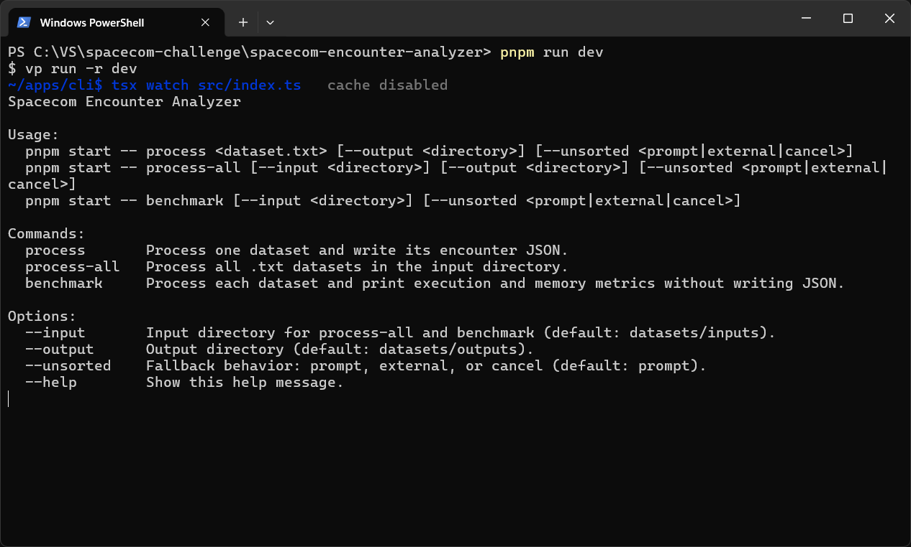
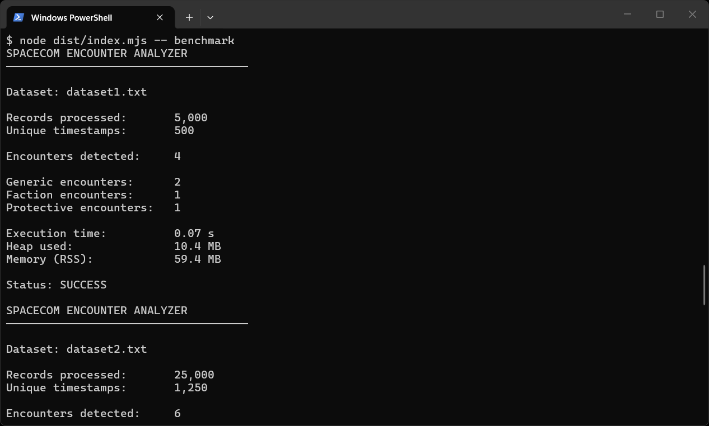

# Spacecom Encounter Analyzer

[Leia em português](README.pt-BR.md)

Spacecom Encounter Analyzer is a Node.js/TypeScript solution to the Spacecom Trainee Tech 2027 encounter-detection challenge. It analyzes geolocation datasets and detects encounters between monitored individuals. The repository is a pnpm monorepo containing the CLI and its encounter-analysis engine.

## Screenshots

The CLI provides commands for processing datasets and measuring execution and memory usage:



The benchmark command reports a summary for each dataset without writing JSON files:



## Current architecture

```text
apps/
  cli/       Node.js CLI
packages/
  config/    Shared TypeScript configuration
  engine/    Reusable engine package, domain types, and dataset infrastructure
```

For component-specific details, see the [CLI README](apps/cli/README.md) and the [engine README](packages/engine/README.md).

## Challenge rules and solution

The solution follows the challenge's required JavaScript/TypeScript runtime, dataset schema, encounter output, and distance rules:

- Input is semicolon-delimited and must use the specified seven-column header.
- Positions are compared only when their timestamps match exactly.
- Haversine distance uses the challenge's Earth radius of 6,371,000 meters. An encounter requires a distance **strictly less than 20 meters**.
- Each unordered pair is reported at most once per timestamp; ID order in the result does not affect whether it is an encounter.
- The output `tipo` is `protetiva`, `faccao`, or `generico`.

### Detection and classification

The engine validates each input row, groups records by timestamp, and finds encounters among candidate pairs narrowed down by a spatial hash index, confirming each distance with the Haversine formula. Encounter types are classified in this order:

1. `protetiva` when either person has a protective measure restricting the other.
2. `faccao` when both people share the same non-empty faction ID.
3. `generico` for any other pair within the distance threshold.

This precedence ensures a protective encounter is not mislabeled as a faction encounter when both rules apply.

### Why this approach

Grouping by exact timestamp prevents comparisons between positions recorded at different times. Streaming input and timestamp grouping avoid loading the entire input file into memory before processing; when timestamps are unordered, the CLI can retry using disk-backed external sorting instead of requiring a full in-memory sort. Spatial indexing within each timestamp group keeps the distance calculation focused on records that can actually form an encounter. The benchmark command reports execution and memory metrics, useful for comparing performance because execution time is the challenge's tie-breaker.

The JSON output contains the encounter type, the two monitored IDs, the timestamp, each person's original coordinates, and the calculated distance in meters. The CLI writes one JSON file per processed dataset under `datasets/outputs` by default.

The streaming grouper expects records in timestamp order and reports an `UnsortedTimestampsError` otherwise. The CLI prompts before retrying an unordered dataset with external sorting. Small datasets can also be grouped in memory through an engine API.

## Technologies

- Node.js with TypeScript and ESM
- pnpm workspaces and workspace catalogs
- Zod 4 for dataset validation
- Varlock for environment variables declared in `.env.schema`, with built-in defaults validated at startup
- Vite+ for task orchestration, linting, formatting, and checks
- Vitest through Vite+ for unit and dataset integration tests
- tsdown/Rolldown for package builds
- Oxlint and Oxfmt through Ultracite
- Husky for Git hooks

## Prerequisites

- Node.js 24.11 or newer
- pnpm 12.14.0

## Installation

```bash
pnpm install
```

## Development

Run all workspace development tasks:

```bash
pnpm dev
```

Run the test suite, including parsing every `.txt` file currently in `datasets/inputs`:

```bash
pnpm test
```

Before each commit, Husky runs the staged-file checks and this test suite. A failed check blocks the commit.

Build the engine and develop only the CLI:

```bash
pnpm dev:cli
```

## CLI commands

Process one dataset and save its JSON under `datasets/outputs`:

```bash
pnpm start -- process datasets/inputs/dataset1.txt
```

Place challenge input files in `datasets/inputs`, then process every `.txt` file in that directory:

```bash
pnpm start -- process-all
pnpm start -- process-all --input ./datasets/inputs --output ./datasets/outputs
```

Run the same processing without writing JSON files and print timing and memory metrics for each dataset:

```bash
pnpm start -- benchmark
```

If timestamps are out of order, the CLI asks whether to retry with disk-backed external sorting. Use `--unsorted external` to select this fallback without a prompt, or `--unsorted cancel` to stop instead.

Command defaults can be configured in the varlock-managed [`.env.schema`](.env.schema); see the [CLI environment variables](apps/cli/README.md#environment-variables).

## Builds

Build all workspace packages:

```bash
pnpm build
```

Build the engine and CLI:

```bash
pnpm build:cli
```

Run the compiled CLI after building:

```bash
pnpm --filter @spacecom-encounter-analyzer/cli start
```

## Type checking and code quality

```bash
pnpm check-types
pnpm lint
pnpm format
pnpm check
pnpm staged
```

Vite+ is the unified interface for these project checks and tests.
