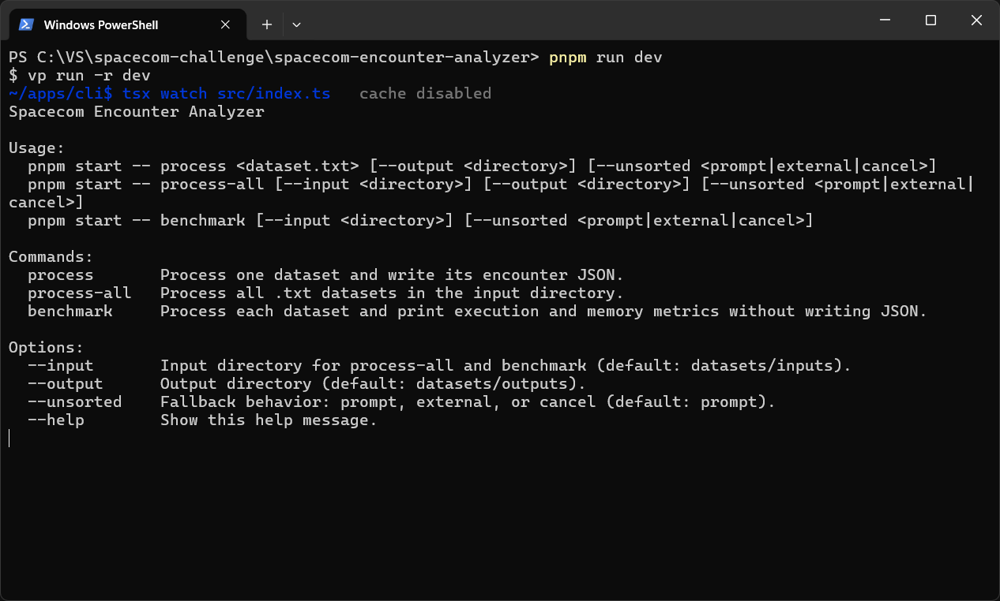
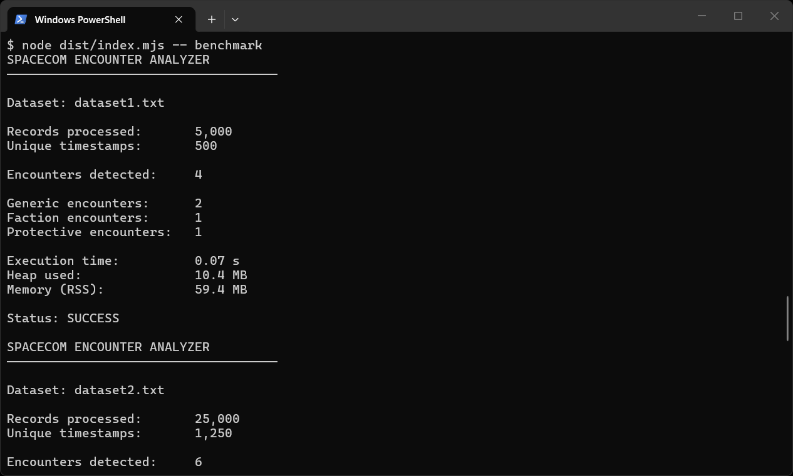
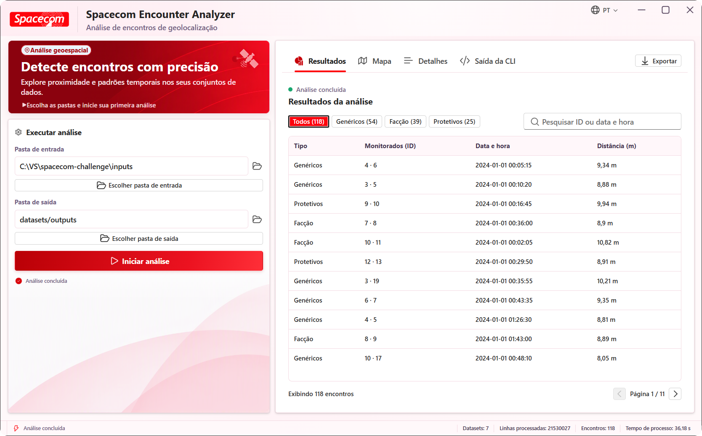
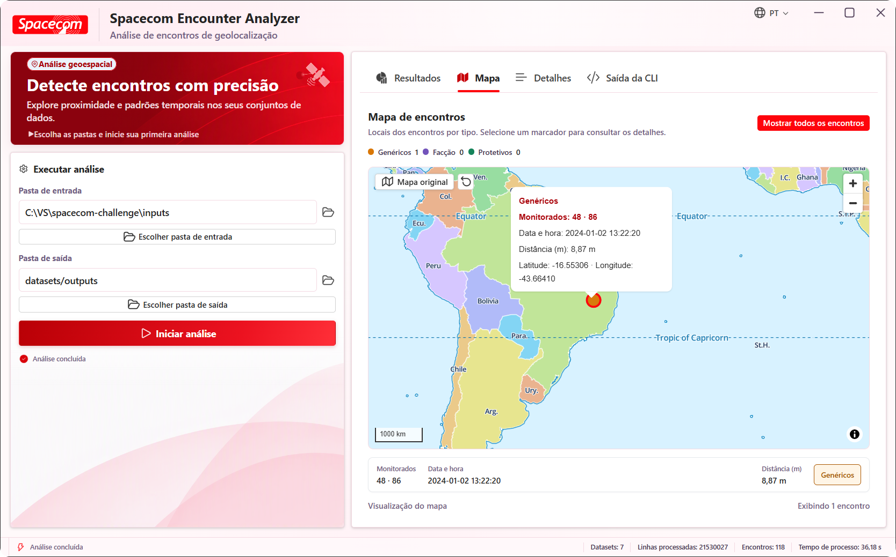
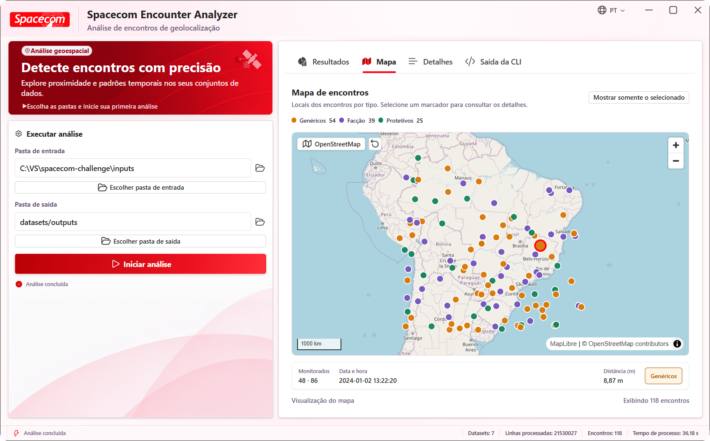
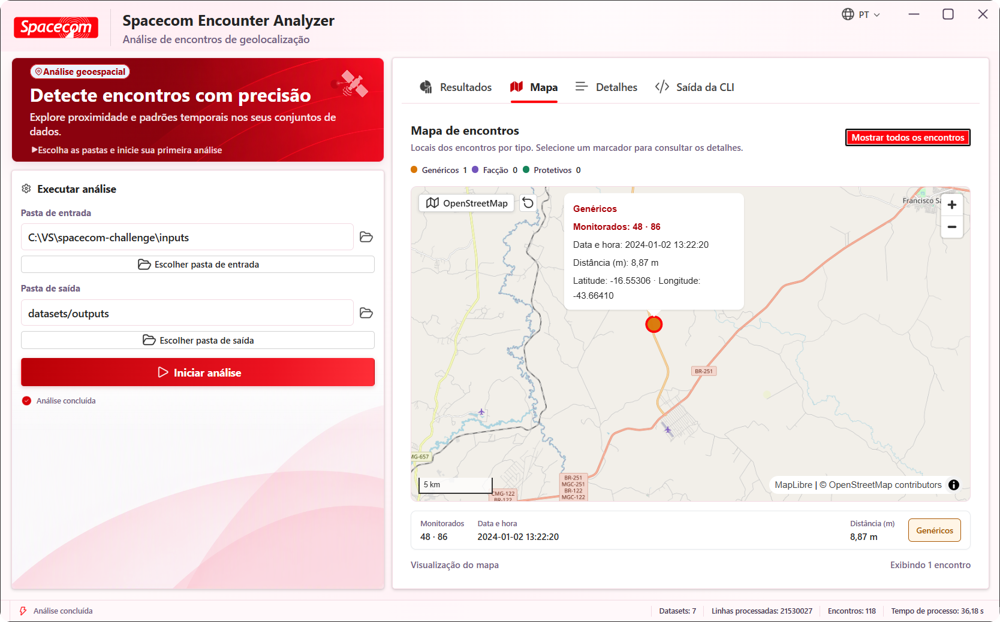
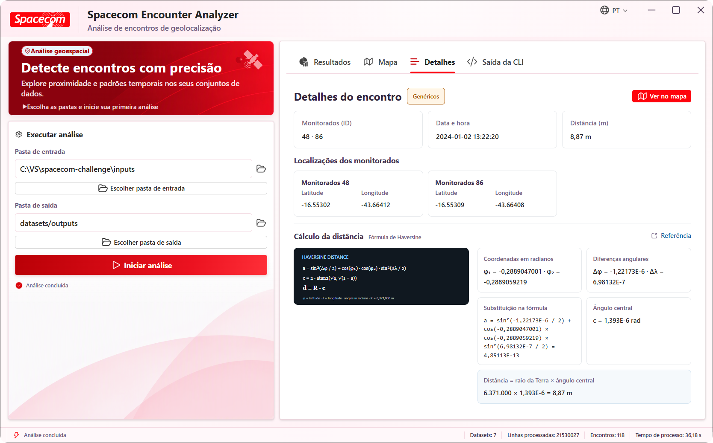
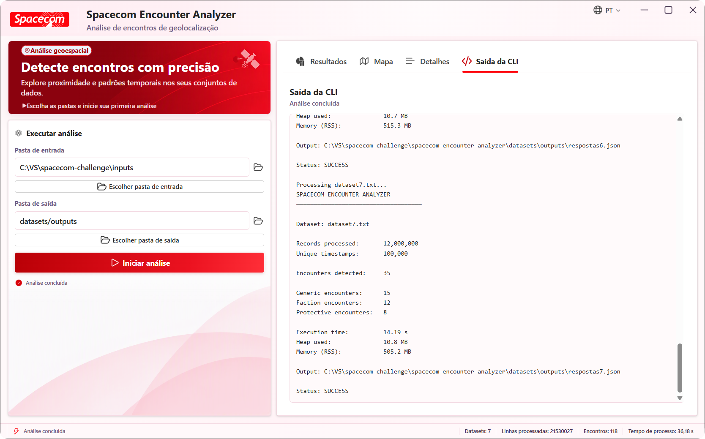
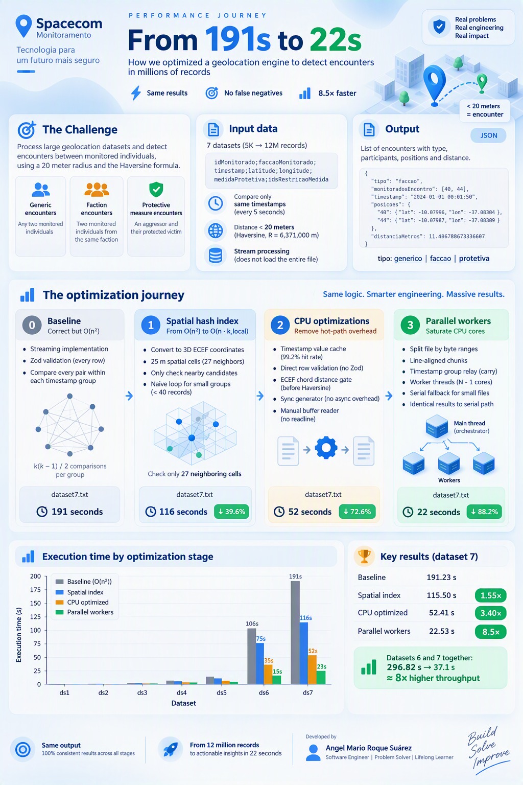

# Spacecom Encounter Analyzer

[Read this README in English](README.md)

O Spacecom Encounter Analyzer é uma solução em Node.js/TypeScript para o desafio de detecção de encontros do Programa Trainee Tech Spacecom 2027. A aplicação analisa conjuntos de dados geográficos e detecta encontros entre indivíduos monitorados. O repositório é um monorepo pnpm que contém a CLI e seu motor de análise de encontros.

## Capturas de tela

A CLI oferece comandos para processar conjuntos de dados e medir o tempo de execução e o uso de memória:



O comando de benchmark exibe um resumo de cada conjunto de dados sem gravar arquivos JSON:



## Aplicativo desktop (extra)

<p align="center">
  
</p>

Como um extra além do que foi solicitado no desafio, também desenvolvi uma interface desktop multiplataforma com Tauri. A tabela de resultados, o mapa, os detalhes dos encontros e a saída da CLI aparecem separadamente abaixo, cada captura centralizada e acompanhada de uma breve explicação:

[Baixe o aplicativo desktop](https://github.com/Angel-Mario/spacecom-encounter-analyzer/releases/latest) na página de releases do GitHub. No Windows, também está disponível o [ZIP portátil da versão 0.1.7](https://github.com/Angel-Mario/spacecom-encounter-analyzer/releases/download/v0.1.7/Spacecom-Encounter-Analyzer_v0.1.7_windows-x64_portable.zip): extraia os arquivos e execute `Spacecom Encounter Analyzer.exe`. O aplicativo portátil requer o [Microsoft Edge WebView2 Runtime](https://developer.microsoft.com/microsoft-edge/webview2/).

**Tabela de resultados:** Consulte os encontros com tipo, IDs dos monitorados, data e hora e distância.

<p align="center"></p>

**Encontro selecionado:** Consulte um encontro no mapa, incluindo sua localização e seu resumo.

<p align="center"></p>

**Todos os encontros no mapa:** Visualize os encontros no Brasil, identificados por tipo e cor.

<p align="center"></p>

**Detalhes do encontro:** Confira as coordenadas de ambos os monitorados e o cálculo da distância de Haversine.

<p align="center"></p>

**Saída da CLI:** Acompanhe o processamento dos conjuntos de dados, a quantidade de encontros e as métricas de desempenho no aplicativo desktop.

<p align="center"></p>

**Saída do conjunto final:** Veja o status de conclusão do processamento do último conjunto de dados.

<p align="center"></p>

## Arquitetura atual

```text
apps/
  cli/       CLI para Node.js
  desktop/   Interface desktop multiplataforma com React e Tauri
packages/
  config/    Configuração compartilhada do TypeScript
  engine/    Motor reutilizável, tipos de domínio e infraestrutura de dados
```

Para detalhes específicos de cada componente, consulte o [README da CLI em português](apps/cli/README.pt-BR.md), o [README do app desktop em português](apps/desktop/README.pt-BR.md) e o [README do motor em português](packages/engine/README.pt-BR.md).

## Regras do desafio e solução

A solução segue os requisitos do desafio para a tecnologia, o formato dos dados, o resultado dos encontros e as regras de distância:

- A entrada é separada por ponto e vírgula e deve usar o cabeçalho especificado com sete colunas.
- As posições só são comparadas quando seus timestamps são exatamente iguais.
- A distância de Haversine usa o raio terrestre exigido de 6.371.000 metros. Um encontro exige distância **menor que 20 metros**.
- Cada par não ordenado é registrado no máximo uma vez por timestamp; a ordem dos IDs no resultado não altera a identificação do encontro.
- O campo `tipo` da saída é `protetiva`, `faccao` ou `generico`.

### Detecção e classificação

O motor valida cada linha de entrada, agrupa os registros por timestamp e identifica encontros entre pares candidatos restringidos por um índice espacial de hash, confirmando cada distância com a fórmula de Haversine. Os tipos de encontro são classificados nesta ordem:

1. `protetiva` quando uma das pessoas possui medida protetiva que restringe a outra.
2. `faccao` quando ambas pertencem à mesma facção não vazia.
3. `generico` para qualquer outro par dentro do limite de distância.

Essa precedência evita classificar como encontro de facção um encontro que também se enquadre como protetivo.

### Por que esta abordagem

O agrupamento por timestamp exato impede comparações entre posições registradas em momentos diferentes. A leitura em fluxo e o agrupamento por timestamp evitam carregar todo o arquivo de entrada na memória antes do processamento; quando os timestamps estão fora de ordem, a CLI pode tentar novamente com ordenação externa em disco, em vez de exigir uma ordenação completa em memória. A indexação espacial dentro de cada grupo limita o cálculo de distância aos registros que podem realmente formar um encontro. O comando de benchmark exibe métricas de tempo e memória, úteis para comparar o desempenho, já que o tempo de execução é o critério de desempate do desafio.

A saída JSON contém o tipo do encontro, os IDs dos dois monitorados, o timestamp, as coordenadas originais de cada pessoa e a distância calculada em metros. Por padrão, a CLI grava um arquivo JSON por conjunto de dados em `datasets/outputs`.

O agrupador em fluxo espera registros ordenados por timestamp e informa um `UnsortedTimestampsError` caso a ordem seja quebrada. A CLI pergunta se deve tentar novamente com ordenação externa. Conjuntos pequenos também podem ser agrupados em memória por uma API do motor.

> A infografia abaixo foi gerada por IA com o objetivo de ajudar o leitor a compreender rapidamente a jornada de otimização. Todos os números e detalhes técnicos são precisos e derivados das execuções de benchmark documentadas em [PERFORMANCE.pt-BR.md](PERFORMANCE.pt-BR.md).



Para uma descrição detalhada do processo de otimização do motor — desde a implementação O(n²) inicial até a arquitetura paralela atual, incluindo hash espacial, gate de corda ECEF, cache de timestamps e paralelização com workers — veja [PERFORMANCE.pt-BR.md](PERFORMANCE.pt-BR.md).

Todos os benchmarks foram executados em um Intel Core i5-10500H (6 núcleos / 12 threads) com o **perfil de energia em economia de energia (baixo desempenho)**. O tempo de ~22 s para o dataset 7 é, portanto, conservador; a mesma execução com o perfil de alto desempenho mediu ~12 s.

## Tecnologias

- Node.js com TypeScript e ESM
- pnpm workspaces e catálogos de dependências
- Zod 4 para validação dos dados
- Varlock para variáveis de ambiente declaradas no `.env.schema`, com padrões e validação no arranque
- Vite+ para execução de tarefas, lint, formatação e verificações
- Vitest via Vite+ para testes unitários e de integração dos conjuntos de dados
- tsdown/Rolldown para compilação dos pacotes
- Oxlint e Oxfmt via Ultracite
- Husky para hooks do Git

## Pré-requisitos

- Node.js 24.11 ou superior
- pnpm 12.14.0

## Instalação

```bash
pnpm install
```

## Desenvolvimento

Execute as tarefas de desenvolvimento de todos os workspaces:

```bash
pnpm dev
```

Execute a suíte de testes, incluindo a análise de cada arquivo `.txt` presente em `datasets/inputs`:

```bash
pnpm test
```

Antes de cada commit, o Husky executa as verificações dos arquivos preparados e esta suíte de testes. Uma verificação com falha impede o commit.

Para uma descrição completa de cada caso de teste, a metodologia de integração dos conjuntos de dados e os benchmarks de desempenho, veja [VALIDATION.md](VALIDATION.md) (em inglês).

Compile o motor e desenvolva somente a CLI:

```bash
pnpm dev:cli
```

## Comandos da CLI

Processe um conjunto de dados e salve o JSON em `datasets/outputs`:

```bash
pnpm start -- process datasets/inputs/dataset1.txt
```

Coloque os arquivos de entrada do desafio em `datasets/inputs` e processe todos os arquivos `.txt` desse diretório:

```bash
pnpm start -- process-all
pnpm start -- process-all --input ./datasets/inputs --output ./datasets/outputs
```

Execute o mesmo processamento sem gravar arquivos JSON e exiba métricas de tempo e memória para cada conjunto de dados:

```bash
pnpm start -- benchmark
```

Se os horários estiverem fora de ordem, a CLI perguntará se deve tentar novamente usando ordenação externa em disco. Use `--unsorted auto` para tentar novamente apenas quando necessário, sem perguntar; `--unsorted external` para sempre usar a ordenação em disco; ou `--unsorted cancel` para cancelar.

Os padrões desses comandos podem ser configurados no [`.env.schema`](.env.schema) declarado com varlock; veja as [variáveis de ambiente da CLI](apps/cli/README.pt-BR.md#variáveis-de-ambiente).

## Compilação

Compile todos os pacotes do workspace:

```bash
pnpm build
```

Compile o motor e a CLI:

```bash
pnpm build:cli
```

Execute a CLI compilada:

```bash
pnpm --filter @spacecom-encounter-analyzer/cli start
```

## Releases do aplicativo desktop

As releases desktop estão disponíveis na página de [releases do GitHub](https://github.com/Angel-Mario/spacecom-encounter-analyzer/releases/latest). Os instaladores são compilados para Windows x64 (`.msi` e `.exe`), macOS Intel e Apple silicon (`.dmg`) e Linux x64 (`.deb` e `.AppImage`). Também há um ZIP portátil para Windows: extraia os arquivos e execute `Spacecom Encounter Analyzer.exe`. Ele requer o [Microsoft Edge WebView2 Runtime](https://developer.microsoft.com/microsoft-edge/webview2/). Os instaladores e o pacote portátil incluem a CLI e o runtime do Node.js, então os usuários não precisam instalar Node.js nem obter o código-fonte. Na primeira inicialização, o aplicativo cria as pastas de entrada e saída no diretório de dados do usuário; também é possível selecionar outras pastas.

Para publicar uma release, atualize a versão do desktop de forma consistente em `apps/desktop/package.json`, `apps/desktop/src-tauri/tauri.conf.json` e `apps/desktop/src-tauri/Cargo.toml`, faça commit e envie essas alterações. Em seguida, envie uma tag com a mesma versão. Para a versão atual `0.1.7`:

```bash
git tag v0.1.7
git push origin v0.1.7
```

O workflow **Desktop release** do GitHub Actions compila cada plataforma e publica uma GitHub Release com os instaladores e o ZIP portátil anexados. O workflow verifica se a tag e os três campos de versão correspondem.

Os DMGs para macOS não têm assinatura nem notarização; o Gatekeeper pode bloquear o aplicativo, e talvez seja necessário permiti-lo manualmente nos Ajustes do Sistema. Os instaladores do Windows não têm assinatura e podem exibir avisos do SmartScreen. Os pacotes `.deb` para Linux declaram as dependências do sistema; usuários do `.AppImage` podem precisar de um runtime WebKitGTK compatível.

## Licença

Este projeto é distribuído sob a [Licença MIT](LICENSE).

## Verificação de tipos e qualidade do código

```bash
pnpm check-types
pnpm lint
pnpm format
pnpm check
pnpm staged
```

O Vite+ é a interface unificada para essas verificações e os testes do projeto.
