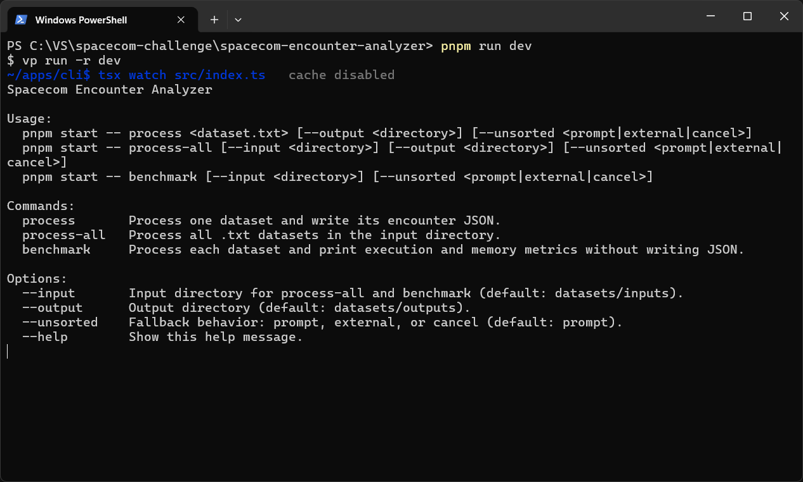
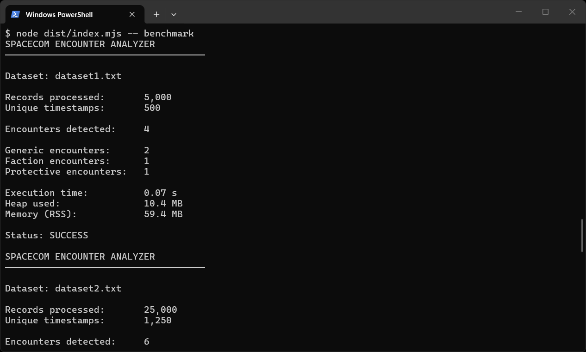

# Spacecom Encounter Analyzer CLI

[Back to the project README](../../README.md)

The CLI is the command-line entry point for the Spacecom Trainee Tech 2027 encounter-detection challenge. It processes geolocation datasets, detects encounters between monitored individuals, and writes one JSON result per dataset. It also provides a benchmark command that reports processing and memory metrics without writing output files.

[Leia este README em português](README.pt-BR.md)

## Requirements

- Node.js 24.11 or newer
- pnpm 12.14.0
- Dependencies installed from the repository root with `pnpm install`

## Run the CLI

From the repository root, process one dataset:

```bash
pnpm start -- process datasets/inputs/dataset1.txt
```

By default, the result is written under `datasets/outputs`. A file named `datasetN.txt` produces `respostasN.json`; other input names produce a JSON file with the same basename. Process all `.txt` files in the default input directory with:

```bash
pnpm start -- process-all
```

Specify input and output directories:

```bash
pnpm start -- process-all --input ./datasets/inputs --output ./datasets/outputs
```

Benchmark every dataset in the input directory without writing JSON:

```bash
pnpm start -- benchmark
```

The benchmark output includes records and unique timestamps processed, encounters by classification, execution time, heap usage, and resident memory (RSS).





## Unsorted timestamps

Datasets are processed in timestamp order by default. If timestamps are out of order, the CLI prompts to retry using disk-backed external sorting. Choose a strategy explicitly to avoid the prompt:

```bash
pnpm start -- process datasets/inputs/dataset1.txt --unsorted external
pnpm start -- process-all --unsorted cancel
pnpm start -- benchmark --input ./datasets/inputs --unsorted external
```

`--unsorted` accepts `prompt` (the default), `auto`, `external`, or `cancel`. `auto` first uses the parallel processing path and falls back to disk-backed sorting only if timestamps are unordered, without prompting; it is suitable for non-interactive applications. `external` always uses disk-backed sorting.

## Environment variables

Values shared by every command are declared in `.env.schema` at the repository root and managed with [varlock](https://varlock.dev), which resolves and validates them before the CLI starts (`dev` and `start` launch the commands through `varlock run`, so `pnpm start` and `pnpm dev` always run with a validated environment; a plain `node dist/index.mjs` falls back to the built-in defaults).

To customize, copy `.env.example` to a git-ignored `.env` file next to `.env.schema` or export the variables in the shell. Explicit CLI options always take precedence over environment values:

| Variable                     | Default                         | Used by                                                                                              |
| ---------------------------- | ------------------------------- | ---------------------------------------------------------------------------------------------------- |
| `SPACECOM_INPUT_DIR`         | `datasets/inputs`               | Default input directory for `process-all` and `benchmark`.                                           |
| `SPACECOM_OUTPUT_DIR`        | `datasets/outputs`              | Default output directory for `process` and `process-all`.                                            |
| `SPACECOM_UNSORTED_STRATEGY` | `prompt`                        | Default for `--unsorted` when the flag is absent; accepts `prompt`, `auto`, `external`, or `cancel`. |
| `SPACECOM_CHUNK_BYTES`       | `8388608` (8 MiB)               | Target byte-range size handed to each parallel engine worker.                                        |
| `SPACECOM_MAX_WORKERS`       | `os.availableParallelism() - 1` | Maximum number of parallel worker threads per dataset.                                               |

`SPACECOM_CHUNK_BYTES` and `SPACECOM_MAX_WORKERS` tune the engine's parallel processing and are ignored when the caller passes explicit engine options (see the [engine README](../../packages/engine/README.md)). Invalid values are rejected by varlock before the process starts.

## Options and defaults

| Option                  | Commands                   | Default            | Description                                                                           |
| ----------------------- | -------------------------- | ------------------ | ------------------------------------------------------------------------------------- |
| `--input <directory>`   | `process-all`, `benchmark` | `datasets/inputs`  | Directory containing `.txt` datasets.                                                 |
| `--output <directory>`  | `process`, `process-all`   | `datasets/outputs` | Directory for encounter JSON files.                                                   |
| `--unsorted <strategy>` | All processing commands    | `prompt`           | Behavior when timestamps are out of order: `prompt`, `auto`, `external`, or `cancel`. |
| `--help`                | Any                        | —                  | Show command usage.                                                                   |

The defaults in this table change when the corresponding environment variables are set; see [Environment variables](#environment-variables).

`benchmark` does not accept `--output`, because it never writes result files.

## Challenge behavior

The CLI delegates parsing and encounter detection to the engine. Only records with the exact same timestamp are compared. A pair is an encounter only when its Haversine distance is strictly less than 20 meters, using an Earth radius of 6,371,000 meters. Results are classified as `protetiva`, `faccao`, or `generico`; protective restrictions take precedence over a shared faction.

The distance calculation uses the Haversine formula:


For further reading, see the [Haversine formula and spherical-distance derivation](https://www.movable-type.co.uk/scripts/latlong.html). For the official runtime APIs used by the CLI, see the Node.js documentation for [streams](https://nodejs.org/api/stream.html) and [file system](https://nodejs.org/api/fs.html).

Each output file is a JSON array. Every encounter contains `tipo`, `monitoradosEncontro`, `timestamp`, `posicoes`, and `distanciaMetros`, matching the challenge's output schema. The original coordinates are retained in `posicoes`.

The `--unsorted` option handles input whose timestamps are not in ascending order. The default `prompt` asks whether to retry with disk-backed external sorting; `auto` retries without prompting only when needed; `external` always selects disk-backed sorting; and `cancel` stops processing. Use `auto`, `external`, or `cancel` in a non-interactive terminal.

## Development

From the repository root, build the engine and run the CLI in watch mode:

```bash
pnpm dev:cli
```

Build the engine and CLI:

```bash
pnpm build:cli
```

Run the compiled CLI:

```bash
pnpm --filter @spacecom-encounter-analyzer/cli start
```

Run the CLI package's development watcher directly from this directory:

```bash
pnpm dev
```

The direct watcher expects the engine package to have been built first. For type checking:

```bash
pnpm check-types
```
