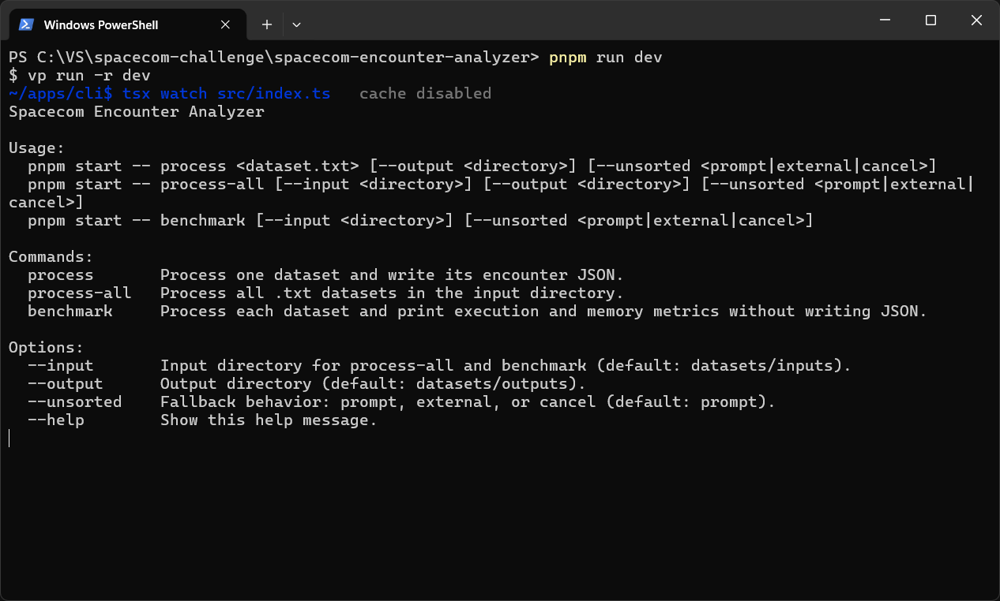
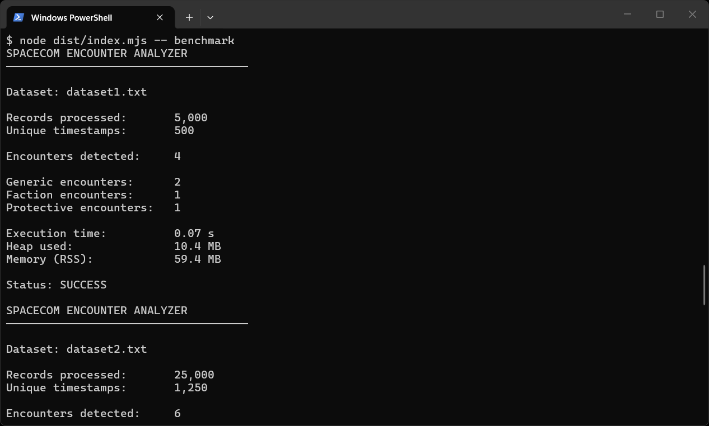
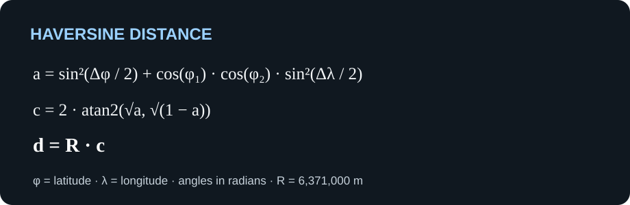

# CLI do Spacecom Encounter Analyzer

[Voltar ao README principal](../../README.pt-BR.md)

[Read this README in English](README.md)

A CLI é a interface de linha de comando do desafio de detecção de encontros do
Programa Trainee Tech Spacecom 2027. Ela processa conjuntos de dados
geográficos, detecta encontros entre indivíduos monitorados e grava um arquivo
JSON por conjunto de dados. Também oferece um comando de benchmark que exibe
métricas de processamento e memória sem gravar arquivos de saída.

## Requisitos

- Node.js 24.11 ou superior
- pnpm 12.14.0
- Dependências instaladas na raiz do repositório com `pnpm install`

## Executar a CLI

Na raiz do repositório, processe um conjunto de dados:

```bash
pnpm start -- process datasets/inputs/dataset1.txt
```

Por padrão, o resultado é gravado em `datasets/outputs`. Um arquivo chamado
`datasetN.txt` gera `respostasN.json`; outros nomes de entrada geram um arquivo
JSON com o mesmo nome-base. Processe todos os arquivos `.txt` do diretório de
entrada padrão:

```bash
pnpm start -- process-all
```

Especifique os diretórios de entrada e saída:

```bash
pnpm start -- process-all --input ./datasets/inputs --output ./datasets/outputs
```

Execute o benchmark de todos os arquivos no diretório de entrada sem gravar
JSON:

```bash
pnpm start -- benchmark
```

A saída do benchmark inclui registros e timestamps únicos processados,
encontros por classificação, tempo de execução, uso de heap e memória
residente (RSS).





## Comportamento do desafio

A CLI delega a leitura dos dados e a detecção de encontros ao motor. Somente
registros com timestamps exatamente iguais são comparados. Um par é considerado
um encontro apenas quando sua distância de Haversine é estritamente menor que
20 metros, usando o raio terrestre de 6.371.000 metros. Os resultados são
classificados como `protetiva`, `faccao` ou `generico`; medidas protetivas têm
prioridade sobre uma facção compartilhada.

A distância é calculada pela fórmula de Haversine:



Para estudar a fórmula e a distância esférica, consulte a
[referência sobre a fórmula de Haversine](https://www.movable-type.co.uk/scripts/latlong.html).
Para conhecer as APIs oficiais do ambiente usadas pela CLI, consulte a
documentação do Node.js sobre [streams](https://nodejs.org/api/stream.html) e
[sistema de arquivos](https://nodejs.org/api/fs.html).

Cada arquivo de saída é um array JSON. Cada encontro contém `tipo`,
`monitoradosEncontro`, `timestamp`, `posicoes` e `distanciaMetros`, conforme o
formato exigido pelo desafio. As coordenadas originais são mantidas em
`posicoes`.

## Timestamps fora de ordem

O processamento padrão espera timestamps em ordem crescente. Se encontrar uma
ordem inválida, a CLI pergunta se deve tentar novamente com ordenação externa
em disco. Escolha explicitamente uma estratégia para evitar a pergunta:

```bash
pnpm start -- process datasets/inputs/dataset1.txt --unsorted external
pnpm start -- process-all --unsorted cancel
pnpm start -- benchmark --input ./datasets/inputs --unsorted external
```

`--unsorted` aceita `prompt` (padrão), `external` ou `cancel`. Em um terminal
não interativo, use `external` ou `cancel`.

## Opções e padrões

| Opção | Comandos | Padrão | Descrição |
| --- | --- | --- | --- |
| `--input <diretório>` | `process-all`, `benchmark` | `datasets/inputs` | Diretório com os conjuntos de dados `.txt`. |
| `--output <diretório>` | `process`, `process-all` | `datasets/outputs` | Diretório para os arquivos JSON de encontros. |
| `--unsorted <estratégia>` | Todos os comandos de processamento | `prompt` | Ação para timestamps fora de ordem: `prompt`, `external` ou `cancel`. |
| `--help` | Qualquer | — | Exibe a ajuda dos comandos. |

O comando `benchmark` não aceita `--output`, pois não grava arquivos.

## Desenvolvimento

Na raiz do repositório, compile o motor e execute a CLI em modo de observação:

```bash
pnpm dev:cli
```

Compile o motor e a CLI:

```bash
pnpm build:cli
```

Execute a CLI compilada:

```bash
pnpm --filter @spacecom-encounter-analyzer/cli start
```

Execute diretamente o observador de desenvolvimento do pacote, a partir deste
diretório:

```bash
pnpm dev
```

O observador direto exige que o pacote do motor já tenha sido compilado. Para
verificar os tipos:

```bash
pnpm check-types
```
