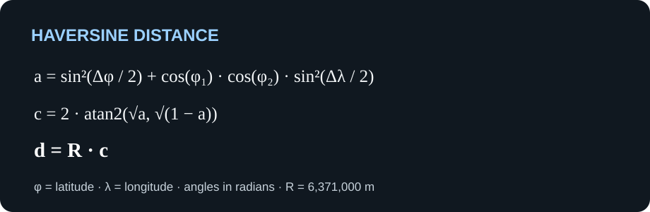

# Spacecom Encounter Analyzer Engine

[Back to the project README](../../README.md)

The engine is the reusable TypeScript package for the Spacecom encounter
detection challenge. It parses datasets, groups records by timestamp, detects
nearby monitored individuals, classifies encounters, and writes JSON output.
The CLI uses this package to process files.

[Leia este README em português](README.pt-BR.md)

## Build and check

Run these commands from the repository root:

```bash
pnpm --filter @spacecom-encounter-analyzer/engine build
pnpm --filter @spacecom-encounter-analyzer/engine check-types
pnpm --filter @spacecom-encounter-analyzer/engine test
```

The package is private to this pnpm workspace and exports its built ESM entry
point from `dist/`.

## Dataset format

Input files are semicolon-delimited text files with this exact header:

```text
idMonitorado;faccaoMonitorado;timestamp;latitude;longitude;medidaProtetiva;idsRestricaoMedida
```

Each subsequent row contains the monitored person's ID, faction ID (or an empty
value), timestamp, latitude, longitude, whether a protective measure applies,
and comma-separated restricted IDs (or an empty value). Timestamps must use
`YYYY-MM-DD HH:MM:SS`; coordinates must be within latitude `-90..90` and
longitude `-180..180`. Invalid headers or rows produce errors that identify the
invalid data.

The challenge uses this record format for all monitored individuals, including
people with protective measures. An empty faction is represented as `null` in
the engine's domain model; an empty restriction list becomes `[]`.

## Processing pipeline

- `readDatasetRecords` streams validated records from a file.
- `readDatasetGroups` streams timestamp groups and requires ascending timestamps.
  It throws `UnsortedTimestampsError` if the order decreases.
- `readDatasetGroupsWithExternalSort` externally sorts records before grouping,
  for unordered input, using temporary disk-backed chunks.
- `detectEncounters` finds pairs less than 20 meters apart within each timestamp
  group. A pair is emitted at most once per group.
- `classifyEncounter` returns `protetiva`, `faccao`, or `generico`, prioritizing
  protective restrictions over shared faction membership.
- `writeJsonOutput` writes classified encounters to a JSON file.

`readDatasetFile` loads every record into memory, and `groupUnsortedByTimestamp`
holds all groups in memory. Prefer the streaming APIs for larger files.

If `readDatasetGroups` throws `UnsortedTimestampsError`, discard any groups
already consumed from that attempt before retrying with external sorting.

## API example

The exported APIs can be composed to stream, detect, and classify encounters:

```ts
import {
  classifyEncounter,
  detectEncounters,
  readDatasetGroups,
} from "@spacecom-encounter-analyzer/engine";

for await (const candidate of detectEncounters(
  readDatasetGroups("datasets/inputs/dataset1.txt"),
)) {
  console.log(classifyEncounter(candidate));
}
```

To read unordered input, replace `readDatasetGroups` with
`readDatasetGroupsWithExternalSort`.

## Encounter rules

Only people with the exact same timestamp are compared. The Haversine
calculation uses an Earth radius of 6,371,000 meters. The distance threshold is
strictly less than 20 meters; at exactly 20 meters, two records do not form an
encounter. Each distinct monitored-ID pair is emitted at most once per
timestamp, and duplicate positions with the same monitored ID do not create an
encounter with each other.

### Haversine distance

The implementation converts latitude and longitude from degrees to radians,
then calculates the central angle and multiplies it by the challenge's Earth
radius:



Here, φ is latitude, λ is longitude, `a` is the haversine term, `c` is the
central angle in radians, and `d` is the distance in meters. The Earth radius
is `R = 6,371,000 m`.

For a step-by-step explanation of the spherical formula, see
[Movable Type's Haversine reference](https://www.movable-type.co.uk/scripts/latlong.html).
For additional background on geodesic distance, see the
[GeographicLib geodesics documentation](https://geographiclib.sourceforge.io/html/python/geodesics.html);
it describes ellipsoidal geodesics, while this challenge specifically
requires the spherical Haversine calculation.

Encounters are classified as `protetiva` when either person has a protective
measure restricting the other; otherwise, they are `faccao` when both people
share a non-empty faction ID, and `generico` in all other cases. This precedence
is important because encounter categories can overlap.

The detector checks all pairs within a timestamp group, so its work for a
group grows quadratically with that group's number of records. Grouping by
timestamp avoids comparing records that cannot match under the challenge rules.
Streaming input avoids first loading the full dataset, while external sorting
supports out-of-order files without an in-memory sort. Callers that need to
write a challenge output can classify the yielded candidates and pass the
resulting encounters to `writeJsonOutput`.

## Output format

`classifyEncounter` returns an object with this challenge-compatible shape:

```json
{
  "tipo": "faccao",
  "monitoradosEncontro": [40, 44],
  "timestamp": "2024-01-01 00:01:50",
  "posicoes": {
    "40": { "lat": -10.07996, "lon": -37.08384 },
    "44": { "lat": -10.07987, "lon": -37.08389 }
  },
  "distanciaMetros": 11.406788673336607
}
```

The output file is a JSON array of these objects. The order of IDs in
`monitoradosEncontro` does not change encounter semantics.

## Official documentation

- [Node.js streams](https://nodejs.org/api/stream.html) — the stream APIs used to
  read large input files incrementally.
- [Node.js file system](https://nodejs.org/api/fs.html) — file and directory
  operations used by the readers, sorter, and output writer.
- [Zod](https://zod.dev/) — the schema-validation library used for dataset
  headers and rows.
