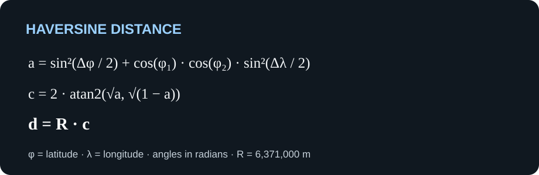

# Motor do Spacecom Encounter Analyzer

[Voltar ao README principal](../../README.pt-BR.md)

[Read this README in English](README.md)

O motor é o pacote TypeScript reutilizável do desafio de detecção de encontros da Spacecom. Ele interpreta conjuntos de dados, agrupa registros por timestamp, detecta indivíduos monitorados próximos, classifica encontros e grava a saída em JSON. A CLI usa este pacote para processar arquivos.

## Compilar e verificar

Execute os comandos a seguir na raiz do repositório:

```bash
pnpm --filter @spacecom-encounter-analyzer/engine build
pnpm --filter @spacecom-encounter-analyzer/engine check-types
pnpm --filter @spacecom-encounter-analyzer/engine test
```

O pacote é privado deste workspace pnpm e exporta seu ponto de entrada ESM compilado em `dist/`.

## Formato dos dados

Os arquivos de entrada são textos separados por ponto e vírgula e devem ter exatamente este cabeçalho:

```text
idMonitorado;faccaoMonitorado;timestamp;latitude;longitude;medidaProtetiva;idsRestricaoMedida
```

Cada linha seguinte contém o ID da pessoa monitorada, o ID da facção (ou vazio), o timestamp, a latitude, a longitude, a indicação de medida protetiva e os IDs com restrição separados por vírgula (ou vazio). O timestamp deve usar o formato `YYYY-MM-DD HH:MM:SS`; as coordenadas devem estar nos intervalos de latitude `-90..90` e longitude `-180..180`. Cabeçalhos ou linhas inválidas geram erros que identificam os dados inválidos.

O desafio usa esse formato para todas as pessoas monitoradas, inclusive as que possuem medidas protetivas. Uma facção vazia é representada como `null` no modelo de domínio do motor; uma lista de restrições vazia é representada como `[]`.

## Etapas do processamento

- `readDatasetRecords` lê registros validados de um arquivo em fluxo.
- `readDatasetGroups` produz grupos por timestamp e exige ordem crescente. Se a ordem decrescer, lança `UnsortedTimestampsError`.
- `readDatasetGroupsWithExternalSort` ordena externamente os registros antes do agrupamento, para entradas fora de ordem, usando blocos temporários em disco.
- `detectEncounters` encontra pares a menos de 20 metros dentro de cada grupo de timestamp. Cada par é emitido no máximo uma vez por grupo.
- `classifyEncounter` classifica como `protetiva`, `faccao` ou `generico`, priorizando restrições protetivas sobre facção compartilhada.
- `writeJsonOutput` grava os encontros classificados em um arquivo JSON.

`readDatasetFile` carrega todos os registros na memória, e `groupUnsortedByTimestamp` mantém todos os grupos em memória. Para arquivos maiores, prefira as APIs de fluxo.

Se `readDatasetGroups` lançar `UnsortedTimestampsError`, descarte os grupos já consumidos nessa tentativa antes de tentar novamente com ordenação externa.

## Processamento paralelo

Arquivos grandes podem ser divididos entre threads de trabalho com `analyzeDatasetParallel`. Ela planeja blocos alinhados por linhas, processa cada bloco dentro de um worker e repassa o grupo de timestamp em andamento entre blocos adjacentes, para que o resultado mantenha exatamente a mesma ordem, contagens e mensagens de erro do caminho em fluxo. Arquivos menores que dois blocos processam pelo caminho em fluxo no mesmo processo.

```ts
import { analyzeDatasetParallel } from "@spacecom-encounter-analyzer/engine";

const analysis = await analyzeDatasetParallel("datasets/inputs/dataset7.txt");
console.log(analysis.encounters.length, analysis.records);
```

`options.chunkBytes` ajusta o tamanho alvo por bloco (8 MiB por padrão) e `options.maxWorkers` limita a quantidade de workers (`os.availableParallelism() - 1` por padrão). Quando ambas as opções ficam ausentes, o mesmo ajuste pode ser feito pelas variáveis de ambiente `SPACECOM_CHUNK_BYTES` e `SPACECOM_MAX_WORKERS`, declaradas e validadas pelo [varlock](https://varlock.dev) no `.env.schema` do repositório; os padrões acima valem quando elas não estão definidas. Cada ponto de corte é planejado com uma pequena varredura de janela ao redor da posição alvo, então o custo do planejamento não cresce com o tamanho do arquivo. O maior dataset do desafio processa várias vezes mais rápido que o caminho em fluxo em uma máquina com vários núcleos, com o mesmo resultado de encontros.

## Exemplo de uso da API

As APIs exportadas podem ser combinadas para ler em fluxo, detectar e classificar encontros:

```ts
import {
  classifyEncounter,
  detectEncounters,
  readDatasetGroups,
} from "@spacecom-encounter-analyzer/engine";

for await (const candidate of detectEncounters(readDatasetGroups("datasets/inputs/dataset1.txt"))) {
  console.log(classifyEncounter(candidate));
}
```

Para ler uma entrada fora de ordem, substitua `readDatasetGroups` por `readDatasetGroupsWithExternalSort`.

## Regras de encontro

Somente pessoas com timestamps exatamente iguais são comparadas. O cálculo de Haversine usa o raio terrestre de 6.371.000 metros. O limite é estritamente menor que 20 metros; a exatamente 20 metros, não há encontro. Cada par distinto de IDs de monitorados é emitido no máximo uma vez por timestamp, e posições duplicadas com o mesmo ID não formam um encontro entre si.

### Distância de Haversine

A implementação converte latitude e longitude de graus para radianos, calcula o ângulo central e o multiplica pelo raio terrestre exigido pelo desafio:



Aqui, φ representa a latitude, λ representa a longitude, `a` é o termo haversine, `c` é o ângulo central em radianos e `d` é a distância em metros. O raio terrestre é `R = 6.371.000 m`.

Para uma explicação passo a passo da fórmula esférica, consulte a [referência de Haversine da Movable Type](https://www.movable-type.co.uk/scripts/latlong.html). Para mais contexto sobre distâncias geodésicas, consulte a [documentação do GeographicLib sobre geodésicas](https://geographiclib.sourceforge.io/html/python/geodesics.html); ela descreve geodésicas em um elipsoide, enquanto o desafio exige especificamente o cálculo esférico de Haversine.

O encontro é classificado como `protetiva` quando uma das pessoas possui medida protetiva que restringe a outra; caso contrário, é `faccao` quando ambas compartilham um ID de facção não vazio, ou `generico` nos demais casos. Essa prioridade é importante porque as categorias podem se sobrepor.

O detector restringe os pares candidatos dentro de um grupo de timestamp com um índice espacial de hash em vez de verificar todos os pares; portanto, o trabalho cresce conforme a quantidade de registros no grupo, e não com o seu quadrado. Os registros são mapeados para coordenadas cartesianas geocêntricas e agrupados em células de 25 metros; cada registro avalia apenas candidatos de células vizinhas, com verificações exatas de célula descartando colisões de hash e a ordem dos índices mantendo cada par único. Como qualquer par a menos de 20 metros sempre cai em células adjacentes, nenhum encontro é perdido, e a verificação final de Haversine decide cada distância. Agrupar por timestamp evita comparar registros que não podem formar um encontro segundo as regras do desafio. A leitura em fluxo evita carregar primeiro o arquivo inteiro, e a ordenação externa permite processar arquivos fora de ordem sem uma ordenação em memória. Para gerar uma saída do desafio, o chamador pode classificar os candidatos e passar os encontros resultantes para `writeJsonOutput`.

## Formato da saída

`classifyEncounter` retorna um objeto com esta estrutura compatível com o desafio:

```json
{
  "tipo": "faccao",
  "monitoradosEncontro": [40, 44],
  "timestamp": "2024-01-01 00:01:50",
  "posicoes": {
    "40": { "lat": -10.07996, "lon": -37.08384 },
    "44": { "lat": -10.07987, "lon": -37.08389 }
  },
  "distanciaMetros": 11.406788673336607
}
```

O arquivo de saída é um array JSON desses objetos. A ordem dos IDs em `monitoradosEncontro` não altera a semântica do encontro.

## Documentação oficial

- [Streams do Node.js](https://nodejs.org/api/stream.html) — APIs de fluxo usadas para ler arquivos grandes incrementalmente.
- [Sistema de arquivos do Node.js](https://nodejs.org/api/fs.html) — operações de arquivos e diretórios usadas pelos leitores, pelo ordenador e pelo gravador de saída.
- [Zod](https://zod.dev/) — biblioteca de validação de esquemas usada nos cabeçalhos e registros dos conjuntos de dados.
